# How the Claude Rating works, and the research behind it

The Free Agent Finder ranks players by the **Claude Rating**: how many fantasy points a player is projected to score over the rest of the current matchup, using this league's scoring. This page explains what went into it and what the research found, in plain language.

Last updated Oct 12, 2026 (sections through 122). The research is ongoing; new findings are added here as they land. Every idea tested so far, with its result and whether it changed the site, is listed in the [ideas ledger](ideas-ledger.md).

**It is possible to find ways to boost performance rating predictions.** A test below that found no gain is a record of what that test measured, not a limit on the rating.

**League scoring:** goals 2, assists 1, power-play points 0.5, shorthanded points 0.5, shots 0.1, hits 0.1, blocks 0.5. Goalies: win 2, loss -1, overtime loss +1, goal against -1, save 0.2, shutout 3.

## The short version

1. **Ice time is the best single predictor of next week**, and it should come from the last 5 to 10 games, because role changes show up there first. Scoring stats should use the whole season plus last season. A hot last 5 games is the weakest signal.
2. **Whether a player dresses matters more than anything else.** Scratches, injuries and trips to the AHL mean zero points. Accounting for that is worth more than any modeling trick.
3. **Goalies are all about starts.** Ranking goalies by points per game × team games is no better than picking at random. Ranking by expected starts is about 60% better.
4. **Blocks matter for defensemen only. Hits predict nothing useful for forwards.**
5. **Use all 7 moves each week: 2 skater pickups on Monday, and keep the other 5 for injury swaps and streaming goalies with a confirmed start** on nights your goalies leave a slot open (sections 31-33, redone with the league's real settings in section 37). Carry 2 goalies, not 3. Re-pick for the schedule rather than holding a pickup.
6. **Drop the player with the lowest projected week**, not the lowest season total. That doubles what each move gains.
7. **Empty lineup slots on light nights are the biggest pool of points left**, and the simple Monday plan captures them: the 2 skater pickups on Monday from point 5 go to the best projected weeks, dropping your lowest, with the other moves kept for injury swaps and goalie streams (sections 19, 37). Chasing single nights one at a time loses points.

## How the rating is calculated

For a part-by-part breakdown (what each piece uses, what it changes, how much it was measured to matter and what it leaves alone), see [The Claude Rating, piece by piece](rating-components.md).

- **Skaters:** projected points per game × games left this matchup × the chance he dresses.
  - *Points per game* comes from a model that weighs ice time and power-play time over the last 5, 10 and 20 games, plus shots, blocks, hits, points and expected goals from this season and last season. It also forecasts next week's ice time and power-play time, and lets its strongest inputs combine (section 112).
  - *The chance he dresses* comes from a model of his lineup history this season (games missed in a row, how often he sits, whether past absences looked like scratches or injuries, his ice time in his last game), set game by game, with ESPN's injury status as a cap on top: out 35% (15% if he played the last game but left it early), IR 15%, suspended 0, day-to-day 50% if he missed the last game or 15/50/75% by how much he played in it, and 0 when the note says surgery, long-term IR, out for the season or a return 2+ weeks away (sections 29, 36, 78 and 82). These overrides are logged daily.
- **Goalies:** expected starts in the team's remaining games × his points per start. Expected starts come from his share of recent starts and back-to-backs. Points per start is his own average this season, blended over 15 starts with his last-season rate (itself pulled toward the 2.9 league average; 2.9 if he has no starts last season; section 38). When Daily Faceoff lists a goalie as the **confirmed** starter for tonight or tomorrow, that game counts as a certain start for him and zero for his partner (section 23).
- The badge next to the rating is the player's percentile among forwards, defensemen or goalies across the league.

## How it was tested

- Data: NHL game logs and MoneyPuck expected goals for five regular seasons, 2021-22 to 2025-26 (236,091 skater games, 13,932 goalie games), all scored with this league's settings.
- Each Monday, the model only sees games before that Monday and predicts the Monday to Sunday week that follows. A player who doesn't dress scores 0.
- "Wire players" means skaters outside the top 190 (about what 12 teams roster) who have played in the last 14 days, and goalies outside the top 30.
- Each test season (2023-24, 2024-25, 2025-26) is predicted by a model trained only on earlier seasons, which gives 72 test weeks.
- A second, independent review rebuilt the data from scratch to check the claims. Where it disagreed, the research was rerun (see the end of this page).

## 1. Which stats are stable

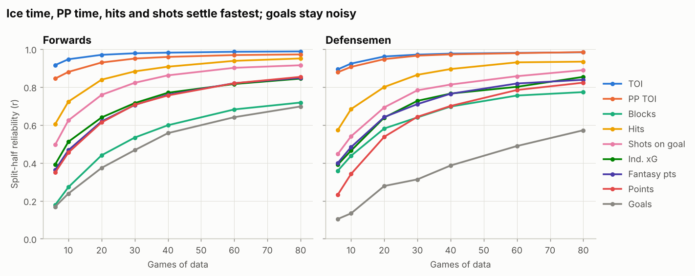

How much a stat in one set of 10 games tells you about another set of 10 games (1 = perfectly repeatable):

| Stat | Forwards | Defensemen |
| --- | --- | --- |
| Ice time | 0.97 | 0.96 |
| Power-play time | 0.93 | 0.95 |
| Hits | 0.84 | 0.80 |
| Shots on goal | 0.76 | 0.69 |
| Expected goals | 0.64 | 0.64 |
| Fantasy points | 0.62 | 0.64 |
| Blocks | 0.44 | 0.58 |
| Goals | 0.37 | 0.28 |

Ice time is almost perfectly repeatable. Goals are mostly noise over 10 games.

## 2. What predicts next week

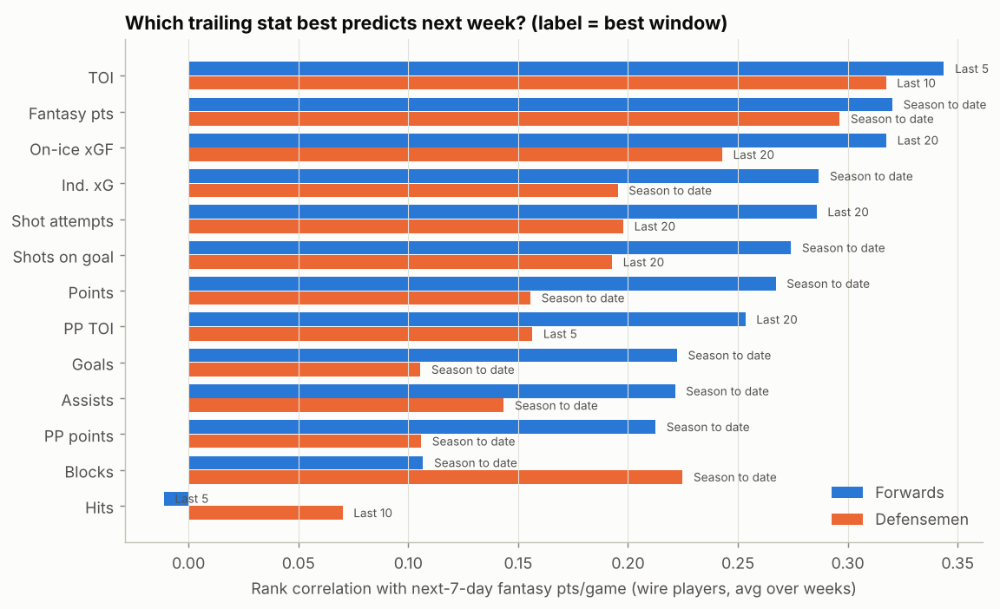

How well each stat ranks wire players by next week's points per game (higher is better):

- **Forwards:** ice time over the last 5 games 0.34, season points per game 0.32, on-ice expected goals 0.32, shots 0.27, power-play time 0.25, blocks 0.11, hits -0.01.
- **Defensemen:** ice time over the last 10 games 0.32, season points per game 0.30, blocks 0.23, shots 0.19, power-play time 0.16, hits 0.07.

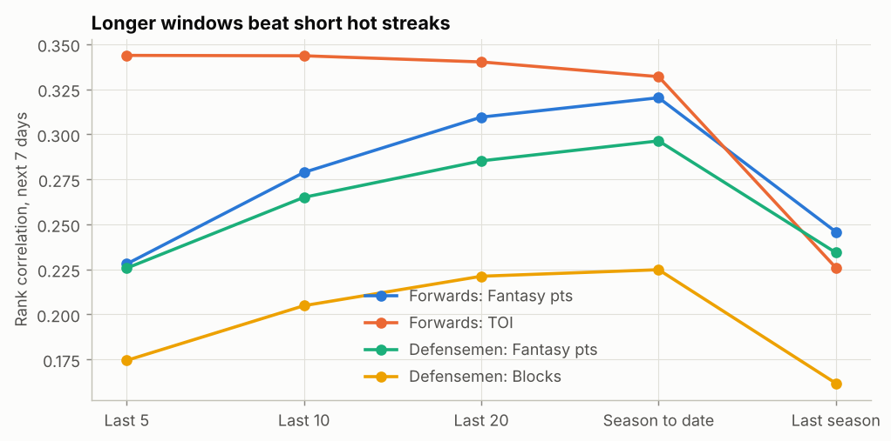

Fantasy points over the last 5 games score only 0.23, rising to 0.32 for the whole season. Hot streaks fade.

## 3. Choosing the model

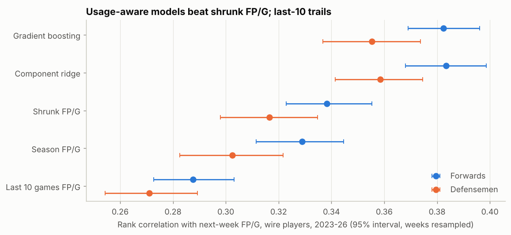

| Model | Forwards | Defensemen |
| --- | --- | --- |
| Last 10 games points per game | 0.29 | 0.27 |
| Season points per game | 0.33 | 0.30 |
| Season points per game, pulled toward last season | 0.34 | 0.32 |
| **Per-stat model with recent ice time (used on the site)** | **0.38** | **0.36** |
| Gradient boosting (more complex) | 0.38 | 0.36 |

The per-stat model wins in all three test seasons. The more complex model adds nothing, so the simpler one is used, which also lets the site explain each number.

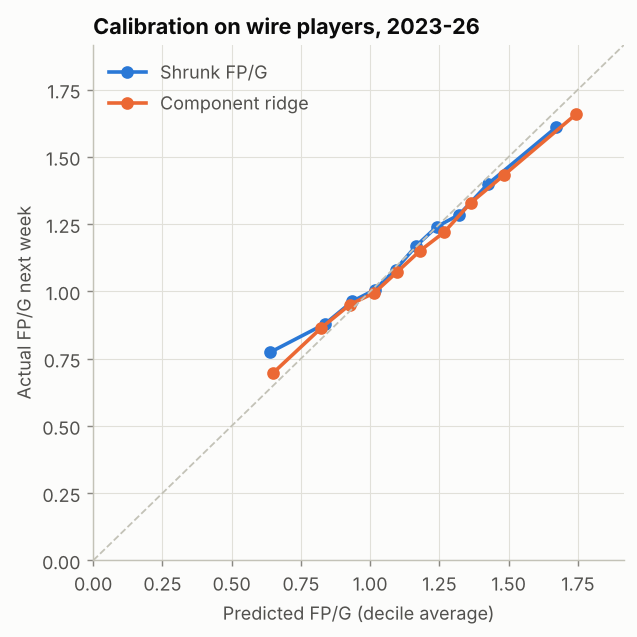

Its projections line up with what players actually scored, without bias up or down.

## 4. Will he dress?

Chance a wire player dresses for a team game, by how many of the team's last 3 games he played:

| Played in last 3 | Chance he dresses | Weeks with zero games |
| --- | --- | --- |
| 0 of 3 | 22% | 65% |
| 1 of 3 | 48% | 35% |
| 2 of 3 | 63% | 21% |
| 3 of 3 | 93% | 2% |

About 11% of wire player-weeks had zero games. The independent review found 24 to 26% when players who hadn't played recently were included, and showed that filtering for regulars raised the top 5 pickups from 5.0 to 6.5 points a week.

## 5. What it's worth when picking up players

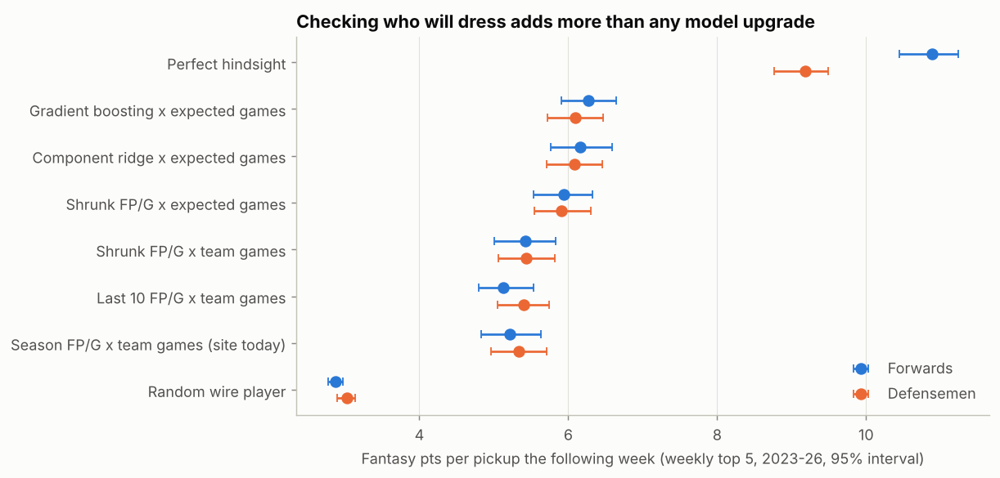

Points scored the following week by each method's top 5 wire picks:

| Method | Forwards | Defensemen | Picks who never played |
| --- | --- | --- | --- |
| Random wire player | 2.9 | 3.0 | |
| Points per game × team games (the old site) | 5.2 | 5.3 | 6% / 8% |
| **Claude Rating** | **6.2** | **6.1** | 1% / 2% |
| Perfect hindsight | 10.9 | 9.2 | |

That's about 1 extra point per forward pickup per week over the old ranking.

## 6. Goalies

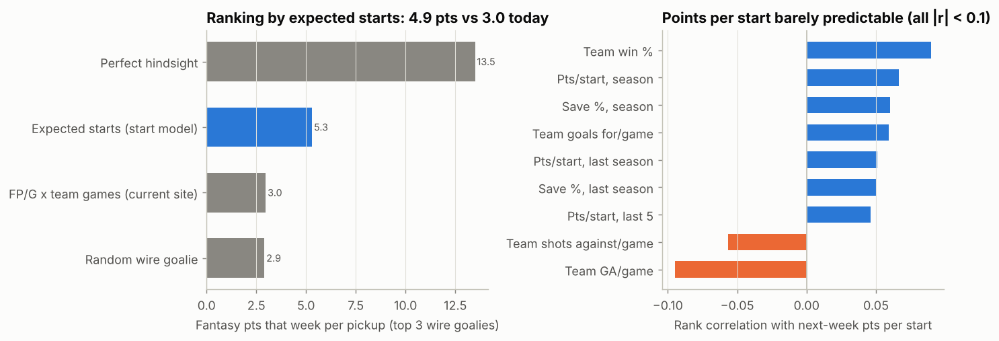

- **Starts:** the start model misses by 0.58 starts a week, versus 1.78 for assuming every team game. Starting the first night of a back-to-back nearly rules out the second night.
- **Points per start, from season stats:** nothing tested here ranks next week's points per start better than chance (all under 0.1). Team win % is the best at 0.09. So the site starts from the league average, about 2.9 points per start, and only slowly moves toward a goalie's own number (section 22).
- **Ranking wire goalies:** points per game × team games gives 3.0 points a week (random is 2.9). Expected starts gives 4.9.

### Rest and workload

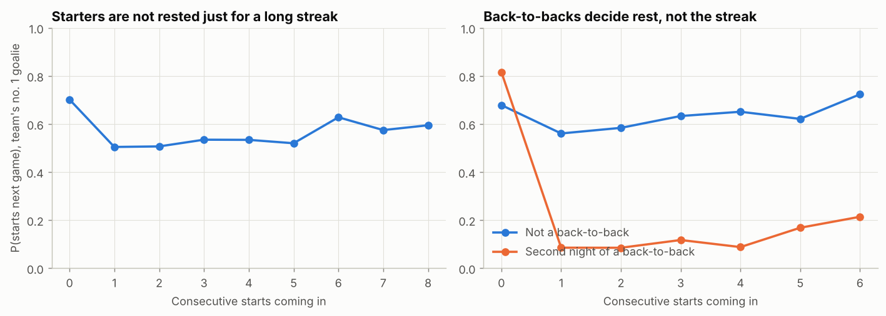

- A long run of starts doesn't get a starter rested: he starts the next game 50 to 63% of the time whether he has started 1 or 8 in a row. (Later, with the full start model, a goalie 5 to 7 straight starts in started 56% of next games against 70% shown, so the site now trims his chance: section 90.)
- The back-to-back is what matters. On the second night, after starting the first, he starts only 9 to 20% of the time.
- Days since his last start: 1 day 11%, 2 days 57%, 3 to 5 days 71 to 76%, 7+ days under 50% (usually hurt or benched).
- Adding these to the start model cut its weekly error by 5%.

## 7. Would checking the news help?

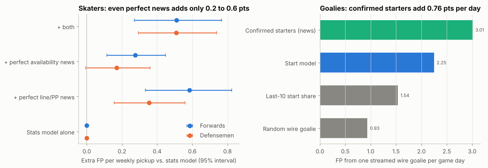

This measures the most news could ever add, by giving the model perfect knowledge of what news would report:

| What the news would tell us | Extra points |
| --- | --- |
| Forwards: exactly who dresses | +0.28 per weekly pickup |
| Forwards: next week's ice time and power-play role | +0.58 per weekly pickup |
| Defensemen: exactly who dresses | +0.17 per weekly pickup |
| Defensemen: next week's ice time and power-play role | +0.35 per weekly pickup |
| **Goalies: confirmed starters, streaming each game day** | **+0.76 per day** |

For skaters, even perfect news adds only 3 to 10%. For goalies it adds about a third, because the start model's top wire goalie actually started only 71% of the time. Starters are usually confirmed after the morning skate, so a goalie news check needs to run around midday ET on game days. The site now gets confirmed starters for free from Daily Faceoff (section 23).

## 8. Opponents, home ice and back-to-backs

| | Per extra goal the opponent allows per game | Home | Second night of a back-to-back |
| --- | --- | --- | --- |
| Forwards (avg 1.36 pts/game) | +0.07 | +0.06 | -0.05 |
| Defensemen (avg 1.43) | +0.05 | +0.02 | -0.01 |
| Goalies, per start (avg 3.17) | -0.25 per extra goal the opponent scores | +0.21 | +0.05 |

Opponent strength changes skater pickups by less than 0.02 points a week, so it's left out. For goalies, home ice is worth about 0.2 points a start, and a weak opponent is a reasonable tie-breaker.

## 9. Using all 6 moves

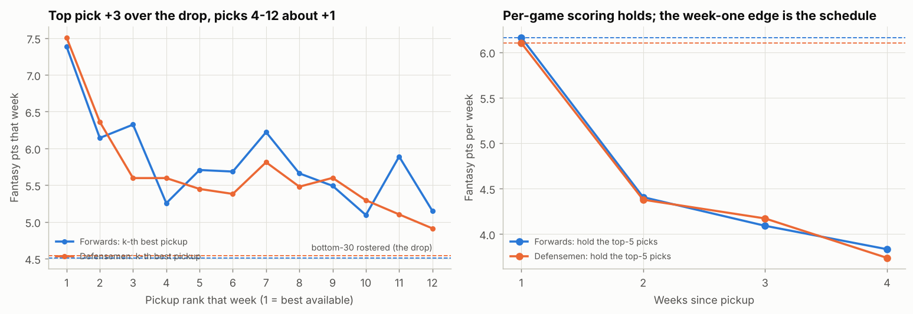

Compared with dropping a typical bottom-of-roster skater (about 4.5 points a week):

| Pickup that week | Net gain |
| --- | --- |
| Best available | about +3.0 |
| 2nd and 3rd best | about +1.5 |
| 4th to 6th best | about +1.0 |
| 7th to 12th best | +0.3 to +1.7, noisy |

- **Use all 6 moves.** Even the 6th pickup beats the drop by about a point a week. (Sections 31-33 found it's better still to hold 4 of them for goalie streams and injuries.) (The league's real limit is 7: section 37.)
- **Re-pick each week.** A top pick scores 6.1 in his first week, then 4.4, 4.1 and 3.8. He's the same player per game; the first-week edge was his schedule, and some picks lose their spot over time.

## 10. Do ice-time jumps stick?

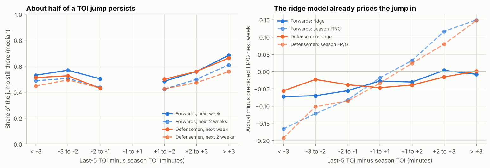

- **About half of an ice-time change lasts.** Jumps of 3+ minutes last best (66 to 68% still there the next week).
- **Power-play time is different.** A power-play time *increase* keeps only 17 to 28%, because short-term PP time mostly reflects how many penalties opponents took. A *decrease* keeps 58 to 66%. So "moved up to PP1" needs a confirmed unit change; "moved off PP1" can be trusted.
- The rating's model already accounts for this, so its error doesn't grow for players with big recent jumps.

## 11. Rookies and call-ups

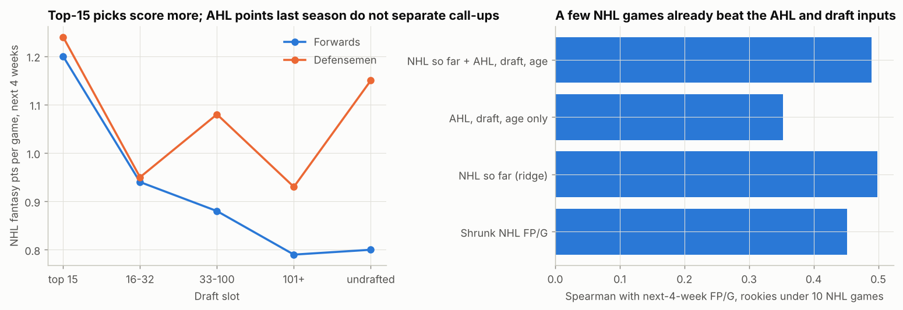

For players with fewer than 10 NHL games, their first few NHL games already predict better than their AHL scoring, draft slot or age. AHL points per game don't separate call-ups at all. What matters is the role he's given: his NHL ice time and power-play time. **No change to the rating**: a player with no NHL games gets the league average, and his minutes take over after one game.

## 12. Power-play unit and mid-season retraining

- **"On PP1"** looks important, but it adds nothing once the model knows his power-play minutes. It's a useful label, not an input.
- **Retraining during the season** doesn't help: a model trained on past seasons is as good in March as one retrained monthly. Accuracy rises through the season only because the season-to-date stats get longer. The model is trained once a year.

## 13. ESPN injury status

On Oct 8, six players ESPN listed as OUT were still rated 87 to 95% likely to dress, because they had played the games before getting hurt. ESPN's flag removes that lag. Among players who had dressed in all of their team's last 3 games, about 1% then scored a zero week, worth about 0.9 points per roster each week. The site now sets OUT, IR and suspended players to 0 and caps day-to-day at 50%. (Changed later: see sections 36, 78 and 82.)

## 14. Who to drop

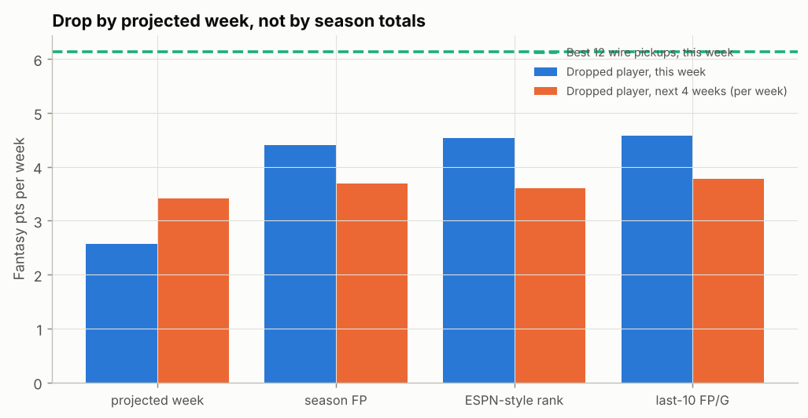

Four ways of picking the 12 rostered skaters to drop each week, against the 12 best free agent pickups (6.1 points that week):

| Drop the player with the lowest… | His points that week | Net gain from the move | Drops that outscore the pickup |
| --- | --- | --- | --- |
| **Projected points this matchup (Claude Rating)** | **2.6** | **+3.6** | 11% |
| Season points total | 4.4 | +1.7 | 24% |
| ESPN-style rank | 4.5 | +1.6 | 26% |
| Last 10 games points per game | 4.6 | +1.6 | 27% |

Dropping by projected points doubles what each move gains, partly because that player has fewer games or is less likely to dress that week. It doesn't cost you a better player later: the dropped players score about the same over the next month under every rule. The site's **Drop list** shows your team's five lowest keep values (section 35).

## 15. Light nights and open slots

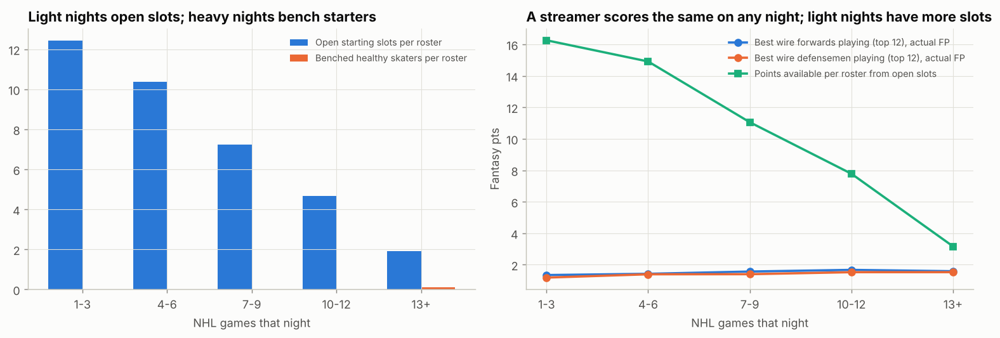

Simulating 12 rosters in this league's format:

| NHL games that night | Open lineup slots per roster | Points available from open slots |
| --- | --- | --- |
| 1-3 | 12.4 | 16.3 |
| 4-6 | 10.4 | 14.9 |
| 7-9 | 7.2 | 11.1 |
| 10-12 | 4.7 | 7.8 |
| 13+ | 1.9 | 3.2 |

- A typical roster has about 28 empty starting slots a week, worth about 72 points if every one were filled. About two thirds of that is on nights with 6 or fewer games. The 6-move limit means only part of it is reachable, but it's the largest pool of points in this study.
- A streamer scores about the same on any night, so what matters is simply whether he plays on a night your slot is open. The site's **Open** column counts exactly that for each free agent, for the team you pick.

## 16. The UTL slot

No skater in this league is eligible at both forward and defense, and the lineup uses general F slots, so forward eligibility never matters. UTL only comes into play on nights with 13+ games, and there the 6th defenseman outscored the 10th forward (1.40 vs 1.30 points). **The site counts UTL as a sixth D slot** when working out open slots.

## 17. Coming back from injury

Across 2,012 returns from absences of 2+ weeks, players scored at their old rate right away, even after 8+ weeks out. Ice time in the first 5 games back is only 0.1 to 0.35 minutes lower. **No change to the rating**: a returning player is rated on his pre-injury numbers.

## 18. Things that turned out not to matter

Each of these was added to the model and tested over three seasons. None changed its accuracy by more than a rounding error.

| Idea | Result |
| --- | --- |
| How much his team shoots and scores | Nothing. His own ice time, shots and expected goals already carry his team's pace. |
| Each team's goalie rotation habits | Teams differ, but the habit doesn't carry from one season to the next (it follows the goalies, not the coach). A per-team model was worse. |
| Hits for forwards | Worth exactly their 0.1 points each, no more and no less. Forwards who hit a lot score less only because they're fourth-liners. |
| Shot quality and finishing skill | Finishing is a real but small skill, and last season's goals and expected goals already capture it. |
| Stats from two seasons ago | Last season is enough. Two seasons back helps a tiny bit in October only. |

## 19. Moves: the Monday plan beats daily streaming

Simulating 12 rosters over 72 weeks, each with at most 6 moves a week:

| Strategy | Points per roster per week | vs. no moves |
| --- | --- | --- |
| No moves | 85.8 | |
| **Monday: add the 6 best projected weeks, drop the 6 lowest projected** | **91.2** | **+5.4** |
| Monday, matching pickups to your open-slot nights | 90.8 | +5.0 |
| Daily streaming: fill tonight's open slots until moves run out | 89.1 | +3.3 |

- **The simple Monday plan wins.** That's exactly the site's table (sorted by rating) plus the drop list.
- Matching pickups to open nights doesn't beat it, because the best projected week is usually a 4-game week anyway.
- Daily streaming spends moves on 1-point nights and loses about 2 points a week. Light nights are worth using, but through the weekly ranking, not one night at a time.

## 20. Streaming goalies by opponent

Over 101 weeks of picking the 3 best wire goalies:

| Ranked by | Points from top 3 picks per week |
| --- | --- |
| Expected starts | 5.19 |
| + home ice and opponent strength | 5.07 |
| **+ the goalie's own points per start, pulled toward the league average** | **5.33** |

Opponent strength is noise for goalies (it explains under 1% of points per start). A goalie's own points per start, blended with the league average so that one hot week doesn't swing it, adds a little. **The site now uses it** (section 22).

## 21. Should the rating show a confidence level?

No. Players with few games this season are not projected any worse: the model leans on last season for them, and they're mostly lower-usage players with less to swing. Weekly hockey scoring is noisy for everyone (the typical miss is about 0.55 points a game against an average of 1.3). A "low confidence" badge would tell you to distrust numbers that are as good as any other. Tap a row to see what drives a rating instead.

## 22. What changed on the site from this round

- **Goalies:** expected starts × his own points per start this season, blended with the league average of 2.9 (his own number gets half the weight after 15 starts). Worth about +0.14 points a week on the best streaming picks.
- Nothing else. Injury returns, team shooting, rotation habits, hits, shot quality, older seasons, opponent-based goalie streaming, night-by-night streaming and a confidence badge were all tested and left out.
- **Next to test:** comparing the rating with ESPN's projections over a few weeks of live data, using the log described in section 23.

## 23. Confirmed starting goalies, and what's being logged

The biggest gain left in the research was knowing tonight's starting goalie (section 7: about a third more points per streamed goalie). Daily Faceoff publishes it for every game, so the site now reads it directly, with no AI step needed.

- The site updates at **9 AM, 12:30 PM and 5 PM ET**. Starters are usually confirmed after the morning skate, so the midday run is the one that matters. (A 6 AM run was added later, section 50.)
- A goalie Daily Faceoff marks **Confirmed** for tonight or tomorrow gets that game as a certain start, and his partner gets zero. A confirmed start on the first night of a back-to-back also lowers his chance of starting the second night. The row shows a "starts tonight" or "sits tonight" tag.
- "Likely" and unconfirmed goalies are shown when you tap the row but don't change the rating yet, until the log shows how often they're right.

Every update also saves a log (in `data/log`) of things that might help but need live data to test:

| Logged | Question it answers after three weeks |
| --- | --- |
| Daily Faceoff starters, every label, three times a day | How often "Confirmed" and "Likely" are right, and when they firm up |
| Daily Faceoff projected lineups, power-play units and scratches | Does "not in the projected lineup" predict a scratch better than the current dress estimate? |
| ESPN injury notes (expected return timing) | Do the notes predict games missed better than the flat 50% for day-to-day? |
| DraftKings moneylines and totals (from the NHL's site) | Do betting odds predict a goalie's points per start? |
| Each player's rating and ESPN's projection | Which one picks better free agents (section 25 of the research)? |

## 24. Betting lines for goalies

A goalie's points depend heavily on whether his team wins (a win and a loss are 3 points apart), and the betting line is the sharpest estimate of that. Across 3,308 starts with closing lines from 2021-22 and 2022-23:

| Chance to win, from the betting line | Starts | Points per start |
| --- | --- | --- |
| under 35% | 475 | 2.8 |
| 35-45% | 757 | 2.9 |
| 45-55% | 844 | 3.7 |
| 55-65% | 757 | 4.2 |
| over 65% | 475 | 4.0 |

- **The line is the first thing found that predicts points per start.** Season win %, goals against and shots against didn't (sections 6 and 20), because they're stale averages. The line already knows tonight's starters, rest and injuries.
- **The site now uses it for tonight's game:** about 2.9 + 4.1 × (win chance − 50%) points per start, so roughly 2.3 for a 35% underdog and 3.5 for a 65% favorite. The lines come from DraftKings through the NHL's site and only exist for today, so the rest of the week still uses the goalie's own points per start. Tap a goalie's row to see tonight's line.
- For skaters the line barely matters: players on teams expected to score 3.5+ goals score about 0.1 points more than usual. That's a tiebreak at most, so it isn't in the rating.

## 25. More ideas that didn't change anything

| Idea | Result |
| --- | --- |
| A fancier "will he dress" model (days since his last game, ice-time rank) | Slightly better, +0.02 points per pickup. The simple version stays. |
| Short-handed ice time | Shorthanded points are rare and unpredictable. No gain. |
| Separate models for forwards and defensemen | A hair better, within noise. |
| Primary vs. secondary assists | Primary assists are more repeatable, but the model already captures it. |
| An "upside" option for weeks you need a big score | High-ceiling players are just the high-projection players. When behind, pick the same players. |
| Two-week matchups | Same per-game projection × two weeks of games. |
| Age | Young players do improve and older ones decline, but recent ice time already shows it. |
| PDO and finishing luck | A player whose team shoots and saves unusually well with him on the ice (PDO), or who scores well above his expected goals, is mostly running lucky. The rating already expects him to cool off because it projects goals from shots and chances (see section 26). |

## 26. Expected vs. actual points

A second research thread built an expected-points number. It's what a player's season would be worth if his goals and assists matched the quality of chances he and his linemates created, keeping his shots, hits and blocks as they are.

- **Expected beats actual as a predictor.** Season expected points per game predicts the next month better than season points per game, in all three test seasons, especially for defensemen.
- **Most of a gap is luck.** About three quarters of the difference between a player's actual and expected points fades within 4 weeks. The luckiest tenth of wire players drop about 0.2 points a game, and the unluckiest rise about as much.
- **Not all of it, though.** Elite finishers like Kucherov, Draisaitl and Nylander beat their chances every year.
- **The rating already does most of this**, since it projects goals from shots and chances. So expected points don't change the rating. When you tap a skater's row, it shows his season points per game next to his expected points. Once he has 15+ games and the gap is 0.15 or more, it also says "running hot" or "running cold".

## 27. Goalie starts in the first two weeks

The start model was built on games from later in the season. On opening week it read one start as a 100/0 split, so after opening night it projected the backup for about 0.8 fewer starts over the next 4 games than backups actually got.

The site now blends in last season's split between a team's goalies until the team's 10th game, fading it out as games are played. Over four seasons this cuts the error in projected starts during a team's first 4 games from 0.84 to 0.67 per goalie. From game 10 on, nothing changes. Daily Faceoff confirmations still override on game days.

## 28. Two ratings: Week and Season

The site shows two numbers for every player:

- **Week** (the Claude Rating): projected points for the rest of this matchup. It counts games left, the chance he dresses, injuries and tonight's goalie news. Use it for this week's pickups and drops.
- **Season**: projected points per team game for the rest of the season. It's the same per-game projection without this week's schedule, and without ESPN's injury discount, so an injured star still rates as a star. For skaters it's projected points per game × the share of his team's remaining games he's expected to play (section 34). For goalies it's his share of his team's starts (this season, blended with last season's split over 10 games) × his points per start. Use it for trades, for players you'd hold beyond this week, and for "is this a real player or a one-week stream".

Why one per-game projection works for the whole season: the research found a model trained for the next week and one trained for the next two weeks agree almost perfectly (0.999), and both predict longer stretches better than shorter ones. Each rating has its own percentile badge within forwards, defensemen or goalies.

## 29. Model upgrade: who plays, ice time, and goalie rest (Oct 9)

Three measured changes went into the rating together. All numbers are rank correlations tested on past seasons, each season predicted only from earlier ones.

| Change | What it does | Before | After |
| --- | --- | --- | --- |
| **Who plays next week** | The chance a skater dresses now comes from his lineup history this season: how many games in a row he has missed, how often he sits, his ice time in his last game, and whether past absences looked like scratches (1-2 games) or injuries (3+). A regular who sat the team's last game plays about 42% of next week's games, not the 61% the old table gave him. | Weekly total 0.637 (waiver pool 0.573) | 0.652 (0.594) |
| **Scoring rate per minute × recent ice time** | The model now also sees each player's points per minute (this season plus half of last, pulled toward the position average) times his ice time over the last 5 games, so a role change counts more for an efficient scorer. | Per game 0.520 (waiver 0.389) | 0.522 (0.393); first 6 weeks +0.005 |
| **Goalie rest and workload** | Start chances now use his run of straight starts, days since his last start, and team games and his starts in the last 7 days, not just back-to-backs. | Weekly starts off by 0.59 | 0.56 |

ESPN's injury status still sits on top: out, IR and suspended players are 0, and day-to-day players are capped at 50%. The cap is a ceiling, not a second discount, so a player already marked down for sitting isn't marked down twice. (Changed later: see sections 36, 78 and 82.)

Two ideas were left out: a luck correction for the luckiest tenth of players tested flat or negative, and a blend with a boosted-tree model added +0.002 at the cost of a new library in the daily job.

## 30. When a starting goalie is hurt

When ESPN marks a goalie out, the site used to set his starts to 0 but leave his partner's projection alone, so the backup looked like about 1 start in 4 games. Now the injured goalie's chance of starting each game goes to the healthy goalies on his team, so they share every game. When a regular starter (6+ of the team's last 10 starts) is out, his backup goes from 0.98 to 2.38 projected starts per 4 games, close to the 2.24 starts such backups actually got. A day-to-day goalie keeps half his chance, and the other half goes to his partner. Daily Faceoff confirmations still decide individual games.

## 31. Keep 1-2 moves for mid-week injuries

The Monday plan used to spend all 6 moves at once. A simulation of 12 rosters over 67 weeks tried holding some back: whenever a rostered skater misses his team's most recent game, swap him for the best free agent at his position for the rest of the week, and spend any held moves left on Thursday the usual way.

| Strategy | Skater points per roster per week | vs. all 6 on Monday |
| --- | --- | --- |
| All 6 on Monday | 93.9 | |
| **5 on Monday, 1 held for an injury** | **95.0** | **+1.1** |
| **4 on Monday, 2 held** | **95.3** | **+1.4** |
| 5 on Monday, 1 spent Thursday with no injury swap | 94.2 | +0.3 |

The 6th Monday move is worth about half a point to a point; replacing a player who has stopped dressing is worth 3-4, and a typical roster needs that about once every three weeks. Almost all of the gain is the injury swap, not the timing. ESPN's injury flags should do even better than "missed his last game" (a perfect flag gets +1.7 / +2.0).

**On the site:** the Upgrades card now has a **Mid-week swaps** list for your team: any skater ESPN lists as out, on IR or suspended, or who sat his team's last game while it still plays this week, next to the best free agent at his position by Week rating. Out and IR players are marked IR-eligible, so you can use the IR slot instead of dropping them. A day-to-day star who sat one game is usually better benched than dropped. Goalies weren't part of this test.

## 32. Spend spare moves streaming goalies

Section 31 split the 6 moves between Monday skaters and injury swaps. A goalie with a confirmed start off the wire is worth about 3 points, and each stream costs one move. A simulation of 12 rosters over 67 weeks (each roster holding two good goalies, all 12 streaming against each other) tried every split:

| Skater moves Monday + goalie streams | Points per roster per week | vs. all 6 on skaters |
| --- | --- | --- |
| 6 + 0 | 106.7 | |
| 5 + 1 | 107.7 | +1.0 |
| 4 + 2 | 109.9 | +3.2 |
| **3 + 3** | **111.0** | **+4.3** |
| **2 + 4** | **111.3** | **+4.6** |
| 0 + 6 | 107.9 | +1.2 |

Skater pickups 3 to 6 add less than a point together, while each of the first two or three goalie streams adds 2 to 4. A roster rarely has more than 3 nights a week with an open goalie slot, so a 4th stream often goes unused; those moves still cover injury swaps. The first stream costs a bench skater to make room.

**On the site:** the advice now says 2-3 skater moves on Monday, the rest for goalie streams and injuries. A **Stream a goalie tonight** card appears for your team when fewer than two of your goalies are starting tonight (Daily Faceoff confirmed, or the start model when not yet confirmed). It lists free-agent goalies confirmed to start tonight, ranked by tonight's points per start (priced from the betting line), and your moves left when ESPN reports them. If your league caps goalie starts per week, streams are worth less once you near the cap; the card mentions the cap when ESPN's settings include one.

## 33. Two on Monday, keep four

Sections 31 and 32 tested injury swaps and goalie streams separately. Run together from one budget (injury swaps first each day, then streams), the best split moves to **2 skater moves on Monday and 4 held**:

| Skater moves Monday | Gain vs all 6 on skaters | With a 7-start goalie cap |
| --- | --- | --- |
| 4 | +3.1 | +2.4 |
| 3 | +4.9 | +3.7 |
| **2** | **+5.8** | **+4.1** |

Four spare moves leave room for an injury swap plus the 2-3 goalie streams a roster can use in a week. A cap on goalie starts cuts the gain by about a third but doesn't change the best split. The site's advice now says "2 on Monday, keep 4".

Which free-agent goalie to stream matters much less than streaming one at all: across 627 nights, the best way of picking among confirmed wire starters (weak opponent, or his own points per start) beat a random one by about 0.4 points, against about 3 points for the stream itself. The site keeps ranking them by tonight's betting line, which already combines team and opponent strength.

## 34. A better Season rating: who plays the rest of the season

The Season rating had reused next week's chance of dressing. Tested on its own horizon (every Monday of 2023-24 to 2025-26, points from that Monday to season's end per team game left), it ranked skaters at 0.773 (waiver pool 0.671). Knowing each player's real share of games played would lift that to 0.91, while knowing his real points per game would only reach 0.89, so availability is where the error was.

The new model predicts the share of the team's remaining games he plays. It uses the same lineup history as the weekly model, plus last season's games played, ice time, games left and a simple "in the lineup or out k games" chain: how often he drops out after a game he plays, and how likely players are to come back after k games out (31% after one game, 17% after three, 7% after seven for forwards).

| | All skaters | Waiver pool |
| --- | --- | --- |
| Old Season rating | 0.773 | 0.671 |
| **New Season rating** | **0.797** | **0.701** |

With injured players included the gain is bigger (+0.030 / +0.038). An independent rebuild found +0.021 / +0.024. Players out for a while now keep a realistic Season rating: those idle two weeks or more dress for about 27% of the remaining games, not the 7% the old cap implied. Points per game didn't change; three alternatives tied or lost. The Week rating and ESPN's injury caps are unchanged.

## 35. Pick adds and drops by more than this week

Every move simulation before this one scored a single week, so dropping a good player who only had a light week looked free. With rosters carrying over across 8-week stretches, ranking adds and drops by this week alone churns away good players and costs later weeks. Adding about two more weeks of per-game value (7 games) to this week's projection works best:

| Ranking adds and drops by | 2 Monday moves | 6 Monday moves |
| --- | --- | --- |
| This week only (the old site) | baseline | baseline |
| Per-game value only | +0.7 | |
| **This week + 7 games of per-game value** | **+1.75** | **+2.3** |

**On the site:** the upgrade cards and the drop list now rank skaters by this "keep value" (shown next to the Week number). The per-game part uses the Season rating, so an injured star with a long future isn't put on the drop list. The Week column itself is unchanged, and goalies were still ranked on this week (changed in section 48).

## 36. Injured players: how long they're out

ESPN's injury statuses aren't archived anywhere, so the research rebuilt them from 41,905 ESPN/Rotowire news notes. From a Monday, the typical number of further games missed:

| What is known | Median further games missed | Back within 4 games |
| --- | --- | --- |
| Day-to-day, hasn't missed a game yet | 0 | 78% |
| Day-to-day, missed 1-8 | 2-4 | 45-67% |
| Out | 3-5 | 35-51% |
| Injured reserve | 9-14 | 15-26% |
| Surgery or long-term IR | 16 | 12% |
| "Out for the season" | rest of season | 0% |

So the site's old rule (out and IR at 0) was too harsh: those players actually dress for about 25% and 11% of the week's games. **The Week rating now caps an injured skater's chance of dressing at 35% when out, 15% on IR and 50% day-to-day**, and goes to 0 only when ESPN's note says surgery, long-term IR, season-ending, week-to-week, month-to-month, indefinitely, or a return 2+ weeks away. Weekly rank correlation +0.007 overall and +0.009 on the waiver pool, and an independent rebuild found +0.011 to +0.013. It doesn't change which free agent tops the list, but it projects your own injured players more fairly (the drop list, mid-week swaps, who to bench). Tap an injured player to see how many more games players with his status usually miss, or what ESPN's note says.

The Season rating already handled injured players well (section 34), and note-based tweaks didn't improve it. Returning players come back at their old ice time, so nothing changes there either. Goalies keep the old rule.

## 37. The league's real move limit, and how many goalies to carry

The league's ESPN settings say "1 acquisition per scoring period", and the transaction log shows what that means: one move per day of the matchup, pooled and usable any time. That is **7 moves in a normal week** (6 in the 6-day first matchup), not 6, and several can go on the same day (one team made 3 adds in 7 minutes). Teams also carry more than the earlier simulations assumed: about 19 skaters and 3.3 goalies each.

The move plan was re-run with these settings over 67 weeks (2023-24 to 2025-26), with one active manager against 11 teams that never move:

| Plan | Points a week vs all 7 moves Monday |
| --- | --- |
| 6 moves, all Monday | −1.3 |
| 5 Monday + injury swaps, no goalie streams | +0.3 |
| 3 Monday + injury swaps + goalie streams | +4.7 |
| **2 Monday + injury swaps + goalie streams** | **+5.6** |
| 0 Monday + injury swaps + goalie streams | +2.6 |
| **2 goalies + an extra skater, 2 Monday + swaps + streams** | **+7.6** |

So the plan holds: **2 skater moves on Monday, the other 5 for injury swaps and confirmed goalie streams.** And **carrying 2 goalies and using the third roster spot for goalie streams beats carrying a third regular goalie by about 2 points a week**, because the third goalie's starts are easier to get off the wire one confirmed night at a time. That third spot holds whoever you streamed last; it isn't a spare spot for a skater (section 55). With only one manager streaming these gains are on the high side; the earlier runs with all 12 teams streaming ranked the plans the same way.

**On the site:** the Upgrades header states 7 moves and "keep the other 5", the "Stream a goalie tonight" card shows moves left out of 7, and a Goalies card appears when you carry more than 2, naming your weakest goalie this week.

## 38. Goalies: start from last season's level

A goalie's points per start blend his starts this season with 15 starts' worth of a starting point. That starting point used to be the league average (2.9). Scoring the goalie Season rating over 73 Mondays (2023-24 to 2025-26) found that starting from **his own last-season points per start** (itself pulled toward 2.9 over 15 starts) ranks starters better: rank correlation +0.022 (95% +0.013 to +0.031), almost all of it in a team's first 20 games. Pulling harder toward the average (the "Marcel" weighting some projection systems use, about 60 starts) was clearly worse (−0.03). **The site now does this for both the Week and Season goalie ratings.** A goalie with no starts last season still starts from 2.9.

## 39. When a regular comes back, the fill-in sits

When an injured regular returns, someone loses his spot. Over 351 returns in 2023-24 to 2025-26, the healthy skater with the **least ice time at that position (forward or defense) in the team's last game** dressed noticeably less the next week than the dress model predicted: about 8 points of dress share less for forwards and 12 for defensemen. These are almost all waiver-wire players, exactly the fill-ins you might pick up. Fresh call-ups, by contrast, were priced about right already.

**On the site:** when a regular (who dressed 80%+ of games before he got hurt) has missed 3+ straight games and ESPN now lists him healthy or day-to-day, the least-used skater at his position on that team gets his chance of dressing lowered by 8 points (forward) or 12 (defense). Tap the player to see "… is back from injury, so he may sit."

## 40. Tonight's lineup and the best two moves

Two small decision helpers, each worth about a point a week in the backtests (findings 65 and 68):

- **Tonight.** On a night when more of your skaters play than your 9 F / 5 D / 1 UTL slots hold, start by the Claude Rating's points per game and bench the rest. The bigger part of the gain (+0.9 a week) is benching a skater who isn't in Daily Faceoff's lineup for his team, or who sat his team's last game, since he'll likely score nothing. The Upgrades section now shows a "Tonight" card on crowded nights listing who to bench, with those players flagged.
- **Best 2 moves.** For the Monday pickups, taking the two swaps with the biggest keep-value gain over your weakest player *at the same position* beat taking the best free agent overall by +0.9 points a week. The Upgrades section now leads with those two moves, and each drop-list entry shows the best free agent at his position and how much he'd add.

## 41. Goalie starts later in the week: opponent and home ice

Only tonight's goalie starts have a betting line, so the rest of the week's starts used to be worth the goalie's flat points per start. A simple win model, built from each team's goal differential per game (this season, pulled toward half of last season's over 15 games) plus home ice, agrees with the betting market at 0.87 and explains about two thirds of what the line explains about goalie points. Pricing each later start at points per start + 3.4 × (win chance − 0.5) improved the weekly goalie ranking from 0.273 to 0.297 rank correlation, and it was better in all five seasons tested (2021-22 to 2025-26).

**On the site:** the Week rating for goalies now prices every remaining start without a line this way. Tonight's lined starts still use the betting line, and the Season rating is unchanged. Tap a goalie to see "soft schedule" or "tough schedule" and how many points per start it adds or takes away.

## 42. Players hurt before the season started, IR stashes, and an 84-game season

- **Hurt before opening night.** A skater with no games yet this season used to get the same 10% rest-of-season chance of playing as someone who has disappeared from the lineup. But 66 regulars injured before opening night in 2024-26 dressed for 41% of their team's remaining games (45% after a short injury note, 31% after a long one). **The Season rating now uses 45%, 30% for a long injury note, and 0 when ESPN says he's out for the season.** Nugent-Hopkins, back in about a week, was showing a Season rating of 0.17. Keep value and the drop list now treat these players fairly. The Week rating is unchanged.
- **IR stash.** A free agent who is OUT or on injured reserve can go straight into an open IR slot. Over the rest of the season, a 1.5-1.8 pts/game stash beats your weakest skater by about 15-18 points, and a 1.8+ one by about 33, for the cost of one move (about 2 points). Below 1.2 pts/game it never pays. **When you have an open IR slot, an "IR stash" card lists up to 3 such players at 1.5+ pts/game.**
- **84 games.** The 2026-27 regular season is 84 games per team, so the Season rating now counts games left out of 84.

## 43. Goalie Season rating: a little recent form

A goalie's share of his team's remaining starts used to come from his whole season (pulled toward last season early on). Blending in a quarter of a recent-form share, with each game counting half as much every 5 team games back, catches a new no. 1 sooner: rest-of-season errors are 11% smaller right after a starter change, and rank correlation is +0.013 overall. Using recent form alone overreacts, so it stays at a quarter. **The goalie Season rating now uses this blend**; the Week rating's start model is unchanged.

## 44. Keep value counts the real schedule

Keep value (section 35) added this week's projection to about 7 games' worth of the Season rating, the same for everyone. Some teams play 8 games over the next two weeks and others 5, a gap of about 4 points for a typical skater, which is the size of a swap decision. Multiplying the Season rating by each team's actual games in the two matchups after this one ranked players better on those weeks (+0.020 rank correlation, +0.023 among free agents). Keep value briefly used the real number of games, so the upgrade cards, Best 2 moves and the drop list all account for upcoming schedules.

**Reverted.** A season-long hold/drop replay scored actual decisions instead of rankings: the schedule-aware keep value lost about 0.9 points a week against the flat 7 games (95% range: -2.2 to +0.3). The ranking gain on weeks 2-3 doesn't turn into better moves, because next Monday's weekly projection already counts those games when the time comes. **Keep value is back to a flat 7 games.**

## 45. Trade ideas: players ESPN rates the same but Claude doesn't

Other managers judge players by what ESPN shows them. When ESPN projects two skaters at the same position about the same (within 0.05 points a game) but Claude's Season rating has one at least 0.3 points per team game higher, offering the lower-rated one for the higher-rated one won about 1 point a week for the rest of the season in 2023-26 replays. That held in all three seasons and at every stage of the season, and the better-rated player came out ahead about 70% of the time. Trades use none of the 7 weekly moves. The test only counted healthy players with 40+ NHL games the season before, because ESPN may know more than the rating about rookies and new arrivals. **The Upgrades panel now has a Trade ideas card** listing up to 5 such offers (2 per player at most), biggest rating gap first. The other manager still has to accept.

## 46. Two-week playoff rounds

ESPN's league settings put the fantasy playoffs in two rounds of two weeks each, likely Mar 8-21 and Mar 22-Apr 4, 2027. The move limit is 1 per day pooled over the matchup, so a round gets 14 moves. The site used to assume every matchup was one Monday-Sunday week. In the second week of a round it would have shown 0 moves left to a manager who had used 7, and replays put a week with no moves about 20 points behind the 7-move plan. **The site now reads each matchup's length from ESPN.** In a playoff round the move limit, the nights strip and the weekly rating all cover both weeks, and the Upgrades panel suggests about 2 skater moves each Monday, carrying the rest. In the final round keep value counts only the round itself, since nothing after it matters. The fantasy season ends about Apr 4, a week before the NHL's last games.

## 47. Matching ESPN names to NHL players

The rating looks up each ESPN player in the NHL's stats by name and team. Two kinds of name broke that lookup. Vancouver has two players named Elias Pettersson, the star center and a young defenseman, so the site gave up on both and rated the star at 0.10 a game. ESPN also uses short first names where the NHL uses full ones ("Zack" Bolduc for Zachary, "Sam" Montembeault for Samuel, "Joe" Veleno for Joseph), which left those players unrated and ranked with retired names. **The lookup now uses position to split same-name teammates, and accepts a short first name when the last name, team and position group match and the first two letters agree.** The players still unmatched are mostly prospects not on an NHL roster, retired players ESPN still lists, and goalies with no NHL team this season.

## 48. Goalies get keep value too

The Goalies card (shown when you carry 3) used to name the goalie with the fewest points this week as the one to drop. A starter with one game left that isn't his start would show 0 this week, even while starting most of his team's games. Goalies now use the same keep value as skaters: this week plus 7 games' worth of the Season rating, which for a goalie is points per team game from his share of starts. In 828 three-goalie decisions from 2023-26, keep value picked a different goalie 25% of the time. When it did, the goalie it kept was worth about 1 point a week more for the rest of the season. That held in every season. **The Goalies card and the goalie upgrade list now use keep value.** The goalie stream card stays night by night.

## 49. Players who haven't played yet: suspensions and healthy regulars

The Season rating counts how often a player dresses. A skater who hasn't played a game yet got the 10% idle floor, as if he were out of the league. That made suspended Charlie McAvoy, a 2.2-points-a-game defenseman, look like a 0.2 and put him at the top of the drop list. In past seasons, regulars who had sat out the opening games dressed far more often over the rest of the season. Suspended players matched the short-injury rate of 45%, and healthy regulars who hadn't played by the second Monday dressed for 38% of the rest. **Suspended players now take the 45% share, and a healthy skater with 60+ NHL games last season who hasn't played yet takes 38%.** Everyone else keeps the old rule.

## 50. Waiver players, and fresh numbers in the morning

A player someone drops sits on waivers until ESPN's first overnight run (about 3 AM ET) at least 24 hours after the drop. Until then nobody can add him. The site used to count his games from today, so a waiver player could top Best 2 moves partly on games he can't play. **Players on waivers now count only the games after they clear, and their tag says when ("waivers, clears Sun 11").** Waiver goalies are left out of the stream card, since they can't start tonight.

The data used to refresh first at 9 AM ET. Before that the page still showed the previous evening's numbers: last night's games still counted, and on Monday it was still on last week's matchup. Three of the league's first nine adds came before 9 AM, and replays put the cost at about 3.4 points a week for a manager who makes moves in the morning. **The data now also refreshes at 6 AM ET.** When the page shows an earlier day's data, a note says so and the two cards about tonight are hidden.

## 51. A goalie's next start after a bad game

After a starter gives up 5+ goals, or is pulled after giving up 3+, coaches often go to the backup next time. The site's start model gave that goalie a 44% chance of starting the team's next game, but across 2021-26 he started only 31% of them, and the gap showed up in all five seasons. **The site now lowers his chance for the team's next game only, and moves the difference to his partner, until Daily Faceoff confirms a starter.** It's worth about 0.4 projected points for each goalie, mostly on the stream card before starters are confirmed.

## 52. A goalie's next start after any result

The last game's result matters even when it wasn't a disaster. A goalie who won his last start goes back in a little more often than the start model expects, and one who lost goes back in a little less, in every season from 2021 to 2026. A bad start also keeps a smaller drop into the team's game after next. **The site now nudges the last starter's chance up after a win and down after a loss for the team's next game, and keeps part of the bad-start drop for the game after.** About 0.1 of a start moves between partners after an ordinary win or loss, roughly a quarter of a projected point. Measured on seasons the change wasn't fit to, start predictions got about twice as much better as the bad-start rule alone made them. A Daily Faceoff confirmation still overrides it.

## 53. Goalie starts further into the week

To project a week, the site predicts each goalie start in order and treats the likeliest goalie as having started before it predicts the next one. That chaining made it too sure about games later in the week. When it gave a goalie a 90%+ chance three or four games ahead, he actually started only 77-84% of them, so clear no. 1 goalies were overstated by about 0.2 starts every four games. **The site now softens the start chances for every game after the next one, moving them a little toward an even split, and leaves the next game alone.** That cut the overstatement from 0.21 to 0.08 starts and made the predictions better in all five seasons tested. Roughly 0.15 starts a week, about 0.4 projected points, move from clear no. 1s to their partners. A Daily Faceoff confirmation still overrides it.

## 54. Trade ideas across positions

The Trade ideas card used to pair forwards only with forwards and defensemen only with defensemen. In the same 2023-26 replays, forward-for-defenseman trades with the same ESPN projection and a 0.3+ Season rating gap won just as much, about 1 point a week per trade, in all three seasons. Getting a forward was worth a bit more (+1.24) than getting a defenseman (+0.71). **The card now offers trades across positions too**, as long as your roster afterwards still has 11-13 healthy forwards and 6-8 healthy defensemen, the shapes that scored best in the lineup simulations. For Jack's team that took the skaters with a trade idea from 5 to 9 of 15.

## 55. The third goalie spot is the stream slot

The plan the simulations score is 2 regular goalies plus one roster spot that holds the current stream. So a manager following it carries 3 goalies, the third being the last streamer. The Goalies card used to say "use the extra spot on a skater" whenever you had 3. Doing that literally burns a move every time and then forces you to drop a skater on the next stream, which cost about a fifth of a matchup win every 8 weeks in the replays. **With 3 healthy goalies the card now says the third spot is your stream slot and names the goalie to drop for tonight's confirmed starter. It suggests using a spot on a skater only when you carry 4 or more.**

## 56. Trade check

To check a trade you're weighing, the page now has a **Trade check** panel. Pick the players you'd give and the ones you'd get, and it adds up their Season ratings. Across 2023-26, the Season gap between two sides predicted how they really did for the rest of the season: each 1 point of gap per team game was worth about 0.87 points per game in results. So the panel shows **about 0.87 × gap × 3.5 points a week** for the rest of the season, plus how often a gap that size picked the side that really did better: 53% under 0.1, 60% from 0.1 to 0.2, 67% from 0.2 to 0.3, 73% from 0.3 to 0.5, and 87% above that. In an uneven trade, a spot you free up counts as the best healthy free agent at those positions, and a spot you'd need counts as dropping your lowest keep value. Jack's Oct 9 trade, Slavin (1.26) for A. Protas (1.06), reads about −0.6 points a week, with that gap picking the right side 2 times in 3. The test used skaters, so the numbers for goalies are rougher.

## 57. When the moves run out, and the utility slot

Jack used his 7th move by Friday morning in both weeks so far, but the page kept suggesting adds he couldn't make. **When your team has used all its moves for the matchup, the Upgrades cards now say "No moves left this matchup; these are next Monday's targets"** and rank the free agents by Season rating (7 × Season, as in the keep value) instead of this week's points. Separately, the open-slot count treated the utility slot as a sixth D slot even when it was already holding a tenth forward. It now counts the utility slot as an open D only when 9 or fewer forwards and 5 or fewer defensemen play that night. On Saturday Oct 10's 14-game night, that removed a phantom open D for 5 of the 12 teams.

## 58. The chance a skater dresses, game by game

The site used to give a skater one chance of dressing for every game left in the week. That number is right on average over the week, but not game by game. A player who missed his team's last game is less likely to play the very next game than one later in the week: he played only 12% of next games, against the site's 18%. A regular runs the other way, 94.5% next game against 91%. **The site now shifts the chance by game number: down for the next game and up later for a player who is out, and the reverse for a regular.** Weekly totals barely move. Tonight's lineup card now uses the next-game chance, which is the decision it's for. ESPN injury caps and the long-idle cap still apply on top. The pattern held in both test seasons.

## 59. Healthy scratches come back more often than injured players

Section 58 treats every player who missed his team's last game alike. But a healthy scratch is far more likely to be back than an injured player. Healthy scratches carry no ESPN injury status, and the site gave them about a 25% chance per game when they really played 34.5%, in both test seasons, at every game number and however long they had been out. **The site now reads the NHL game page's healthy-scratch list for each team's last game and raises those players' chance of dressing (+0.5 on the log-odds scale, about 25% to 34%).** If the list can't be read, a player who missed the game with no ESPN injury status counts as a healthy scratch. Injured players are unchanged: ESPN's status already handles them. It's worth about 0.3-0.4 points a week for fringe forwards and spare defensemen, mostly in mid-week swaps and keep-or-drop calls.

## 60. Skaters who just changed teams

After a trade or waiver claim, the site judged a player's chance of dressing partly from his old team, where he was often being scratched or only up for a short stint. The new team plays him more: in his first 1-3 games with the new team, a skater who dressed for its last game played 86% of the following games while the site said 78%, in both test seasons. **For those players the site now raises the chance of dressing (+0.45 on the log-odds scale, about 78% to 85%), until his 4th game with the new team.** It's worth about a quarter of a game in a mover's first week, and these are the players people look at on the wire right after a trade.

## 61. Goalies who just changed teams

The goalie start model counts only this season's starts for a goalie's current team. So in his first few starts after a trade or waiver claim he looks like a backup with a tiny sample, even though the team got him to play him. Across five seasons, goalies with 1-3 starts for a new team started the next game 32% of the time; the site said 20%, and it was low in every season. **The site now raises those goalies' start chance (+1.0 on the log-odds scale, before the team's starts are split among its goalies) until his 4th start for the new team.** Goalies called up from the minors with no other NHL team were already about right and are unchanged. It touches about four goalies a season, worth roughly a point a week each while it lasts, and they're the goalies on the wire right after a trade. The Season rating's start share is handled separately (section 62).

## 62. A traded goalie's Season rating counts from when he arrived

The Season rating's long-run start share had the same blind spot. It divided a traded or claimed goalie's starts for his new team by every game that team had played this season, including the games before he got there. So a goalie with 1-3 starts for his new team read as an 11% starter when he went on to make about a third of the team's next 20 starts, and one with 4-8 starts read as 19% against 33%. **His share now counts only the team's games since his first start for it**, same formula as everyone else. That brings him to 29-31% and cuts the error by about a third. Other goalies are unchanged. A share that's 15-20 points too low is worth about 0.4-0.5 points a game of Season rating, enough to make a traded-in starter look like a drop.

## 63. The Season rating for skaters who just changed teams

Section 60 fixed the chance a just-traded skater dresses this week. The Season rating had the same lean: for a skater in his first 10 games with a new team, it expected him to dress for 62-67% of the rest of the season, when such players actually dressed 71-72%. It was low in all four seasons checked. **The Season rating now gives those players a small bump (+0.3 on the log-odds scale, about 6 points of dress share) until his 11th game with the new team.** That's worth about half a point a week of keep value per player. Nearly all of them are free agents, so this mostly affects who shows up as a pickup or next Monday's target after a trade.

## 64. A traded player before his first game for the new team

The site took a skater's team from his last NHL game, not from ESPN. So after a trade, every game his old team played before he suited up for the new one counted as a game he missed. For a few days he looked like a scratch: about 40-50% to dress this week and 30-37% for the next game, when a player in that spot dresses about 90% of the time. That happened about 25-30 times a season, right when people look at him on the wire. **When ESPN lists a skater on a different team from his last game, the site now stops counting his old team's games after his last one and gives him the just-traded boost from section 60 from his first game with the new team.** In the replay that takes him to about 88% for the week and 94% for the next game. His games this week already came from ESPN's team.

## 65. A goalie who leaves no longer keeps his old team's starts

The goalie start model listed as candidates every goalie who had started for the team in its last 20 games, plus the current roster. So after a goalie was traded or waived away, the site kept giving him part of his old team's starts: about 42% of the next start in the first 3 games after he left, fading to 6% by games 13-20. That left the goalies still there, often a backup just promoted to starter, underrated for weeks. **Start shares now count only the goalies on the team's current NHL roster (plus a Daily Faceoff confirmed starter), and each goalie's numbers come from the team whose roster lists him.** In the replay the real starter's chance of starting the next game rose from 47% to 53%. It affects about 5 goalie moves a season, worth roughly 0.3-1 point a week to the old team's new no. 1 while it lasts.

## 66. Goalie Season ratings trimmed for starts that go to goalies not here yet

A goalie's Season rating multiplies his points per start by his long-run share of the team's starts. Across five seasons, the goalies on a team's roster on any given day went on to make only about 94% of its next 20 starts. The other 6% went to goalies who weren't there yet: call-ups, waiver claims and injury fill-ins. So the shares ran high, most clearly for no. 1s: shown at 71%, they actually got 65%. **Every goalie's Season start share is now multiplied by 0.93** (fit at 0.92-0.93 in every season held out, and more accurate in all five). That lowers a no. 1's Season rating by about 0.13 points a game, roughly 0.9 points a week of keep value. It mainly matters where a goalie is weighed against a skater: the third goalie spot, upgrades and cross-position trade ideas. This week's start chances are unchanged.

## 67. A goalie who left his last game early, and low-scoring wins

The chance that last game's starter starts the next one already moves with how that game went: down after a blowup or a pull, up a little after a win, down a little after a loss. A five-season replay of the site's own numbers found three finer cases. **A starter who got no decision** (another goalie came in and the result went to him) started the next game only 12% of the time, while the site gave him the usual ~45%. In 92 of 100 such games the starter had allowed two goals or fewer, so he left early, almost always hurt, before ESPN or Daily Faceoff reported anything. This happens about 20 times a season. **A win allowing 0 or 1 goals** led to the next start 54% of the time against 48% shown. **A blowup** led to it 31% of the time against 36% shown. The site now gives a goalie who left without a decision about a 12% chance of the next start, which hands most of that start to his partner (the one worth streaming). Low-scoring wins get a slightly bigger bump, and blowups a slightly bigger cut. Each fit held in every season left out, and the next-start forecast for last game's starter got more accurate (Brier 0.193 to 0.190). An overtime loss still counts the same as a regulation loss, which the data supports. A Daily Faceoff confirmation still overrides all of this.

## 68. A goalie who left early stays out for days, not one game

Section 67 cut the next-start chance for a starter who left without a decision to about 12%, but only for the next game. From the game after that, the site treated him as a normal starter again (51-59% a game), while in five seasons of replays these goalies started only 19-22% of games 2-4 ahead. They went a median of 6 team games before starting again, 39% started within four games, and 11% never started again that season. **The cut now lasts the rest of the week** (and a whole two-week playoff round), easing slightly after the second game. Over a four-game week that moves about one expected start from him to his partner, worth about 2-3 points to whoever streams the partner, about 20 times a season. The fit held in every season left out, and the forecast for the game after next got much more accurate (Brier 0.31 to 0.16). The cut ends as soon as Daily Faceoff confirms him as a starter again, or once he actually starts.

## 69. A skater who barely played his last game usually misses the next ones

This is the skater version of sections 67-68. A skater who dressed for his team's last game but played under 40% of his usual ice time usually left hurt, often before ESPN flags anything. Because he dressed for that game, the site gave him its "regular" bump and about a 70% chance of dressing next game (62-65% a game across the week). In two seasons of replays, such players dressed for only 18% of the next game and about 24% of the week's games, regulars included. **The site now cuts his dress chance hard for the next game, a bit less for the one after, and still clearly for the rest of the week.** A smaller cut covers the next two games for 40-55% of his usual time (69% shown against 59% actual). Fits held when trained on one season and tested on the other, and the next-game forecast got much more accurate (Brier 0.43 to 0.16). Once ESPN flags an injury, the usual injury rules take over instead. This matters most for the Tonight card and mid-week swaps: about 45 player-weeks a season, each carrying about 1.2 games he wasn't going to play.

## 70. The Season rating for a skater who barely played his last game

Section 69 cut this week's dress chance for a skater who dressed but played well under his usual ice time (likely hurt). His Season rating ran high too: across four seasons, such skaters dressed for 60% of their team's remaining games when the Season rating expected 69% (under 40% of usual ice time), and 56% against 63% (40-55%). It was low in every season. **The Season rating's dress share now gets a small trim for these players**, fit at -0.25 to -0.55 on the logit in every season left out (the site uses -0.4). That is about 0.1 points a game off a 1.2-point skater, roughly 0.7 points a week of keep value. It lasts until he plays a normal game again, and once ESPN flags an injury the injury rules take over. It matters mostly for drop and pickup calls right after an apparent injury.

## 71. The Season rating for a goalie who left his last start early

Sections 67-68 cut this week's start chances for a goalie who left his last start without a decision (nearly always hurt). His Season rating still assumed his usual long-run share of starts: in five seasons of replays, such goalies were credited with 48% of their team's next 20 starts but actually made 33% (no. 1s: 57% credited against 39% made), too high in four of five seasons. **His Season start share is now multiplied by 0.68** (fit at 0.64-0.72 in every season held out) until he starts again or Daily Faceoff confirms him in net. For a no. 1 that is about 0.5 points a game of Season rating, roughly 3.5 points a week of keep value, so the Goalies card no longer treats a goalie who just left hurt as a full keeper. ESPN's injury flag doesn't change goalie Season ratings, so this applies whether or not he has been flagged.

## 72. Just back in the lineup: injured regulars stick, scratched players sit again

Two kinds of skater have just come back into the lineup, and they go opposite ways. **Back from an injury** (he missed 5 or more straight team games, fewer than half of them as a healthy scratch): in his first two games back he dressed 81% of the time, while the site said 73%. Injured regulars go straight back to playing every game. **Back from a short healthy-scratch spell** (sat 1-4 games, mostly on the NHL's scratch list): in his first three games back he dressed 77% of the time against 83% shown, in both seasons checked. Coaches who just sat a rotation player are quick to sit him again. The site now nudges the first group up and the second down, by fits that held in each season left out. To tell the two apart it reads the NHL's healthy-scratch lists for the games each player missed (up to his last 10 games out), only for players who have just come back. If those lists can't be read, a long absence counts as an injury and a short one gets no change. Worth about +0.25 points a week for a 1-point skater back from injury, and a small cut for fringe players on the swap and Tonight cards.

## 73. A goalie who came on in relief starts next more often

The site counts only starts, so a goalie who came on in relief in his team's last game looked like an idle backup. In five seasons of replays he started the next game more often than shown: after the starter was pulled, 58% against 47%; after the starter left hurt, 75% against 65%; after other relief appearances, 65% against 45%. The gap was biggest for a third goalie or call-up with 0-3 of the team's last 20 starts (47% against 23%): a rarely used goalie dressing as the backup usually means the regular backup is hurt or gone. **A goalie who relieved in his team's last game now gets a higher start chance for the next game and a smaller boost for the rest of the week, with a bit more for one who rarely starts.** It predicted starters better in all five seasons held out. A Daily Faceoff confirmation still overrides. This matters for streaming: a call-up who just came on in relief is a real stream for the next few games.

## 74. Daily Faceoff names spelled differently

Daily Faceoff and ESPN sometimes spell a name differently: Gabriel and Gabe Perreault, Nicholas and Nick Robertson, Jacob and Jake Middleton, Elias Nils and Elias N. Pettersson, Matthew and Matt Murray. The site matched names exactly, so those four skaters showed as "not in Daily Faceoff's lineup" on every run (and the Tonight card benched them) even though they played every game, and Matt Murray's confirmed start for Nashville on Oct 10 was ignored. **The site now accepts a Daily Faceoff name on the same team with the same last name and the same first two letters of the first name.** Vancouver has two Elias Petterssons, so a name another player matches exactly is never borrowed, and the line (forward or defense) decides between two.

## 75. A status that cleared before the player is back

When ESPN drops a player's injury or suspension status but he hasn't played yet, the site used to treat him like any idle player: 10% a game and a low Season rating. Charlie McAvoy's suspension cleared Sunday morning, and the Best moves card told New York Mess to drop him for Denton Mateychuk. In five seasons of ESPN notes, a player whose suspension ended dressed for 86-89% of his team's next seven games, and a regular activated before his first game dressed for 73% of the next game and about three quarters of the rest of the season. In season, a player whose status cleared while he was still out dressed in 35% of that week's games against the 18% the site showed. **Now a player whose ESPN status cleared within the last week and who hasn't played since gets a much higher chance to dress: 75% for the next game and 80% for later ones (with a Season rating of 72% of his points a game) if he hasn't played this season yet, and a clear boost to this week's and the Season's dress chance if he has.** The boost ends with his first game back.

## 76. Sat the last game, but back in Daily Faceoff's lines

A skater who sat his team's last game gets about a 20% chance for the next one. Daily Faceoff's projected lines, which the site already reads, often know better: in the first live days of the season, all 14 skaters with no injury status who had sat the last game but were in Daily Faceoff's forward or defense lines dressed for the next game. **Such a player now gets at least a 90% chance for the next game, the rest of his week is priced as if he had played the last game, and the Mid-week swaps card no longer suggests replacing him.** This is an early read from a few days of logs and will be rechecked at the end-of-October review.

## 77. Opening games cut short

Jake Sanderson left his only game of the season after four and a half minutes, so the site rated him 0.38 points a game against 2.4 last season. In four seasons of replays, skaters whose 1-3 games this season ended with one under half their usual ice time scored 0.95-0.99 points a game over their next 20 games; the site's number ran 0.32 low, while leaving the short games out ran 0.16 high (players who leave hurt do run a little below last season afterwards). **For a skater with 1-3 games this season whose latest was under half of last season's ice time, the site now averages its usual points a game with the one it gets leaving those short games out.** The error fell from 0.41 to 0.28 points a game, better in all four seasons. From his fourth game on nothing changes. Sanderson goes from 0.38 to about 1.3 points a game.

## 78. Day-to-day players who played the last game

ESPN's day-to-day tag got a flat 50% chance per game. For a skater who played his team's last game, how much he played in it tells far more. In two seasons of injury snapshots, a day-to-day skater whose last game was under 55% of his usual ice time (he left it hurt) dressed for only 8-24% of the next games; at 55-80% about half; at 80% or more 79-97%. **A day-to-day skater who played the last game now gets at most 15% a game if he left it early, 50% if he played a reduced share and 75% if he played his normal minutes.** (The top cap is shaded down from what the history supports because a few full-minute players sat in the first live days.) Prediction error fell by a third in both seasons. A day-to-day skater who missed the last game keeps 50%.

## 79. The starting goalie after a long team break

The start model reads days since a goalie's last start as a sign he's been benched. After a team-wide break of four or more days (holidays, the All-Star break, schedule gaps) everyone is rested, so that reading is wrong: in five seasons of replays, the goalie who started the last game before a 4-6 day break started the next one 57% of the time against 50% predicted, and 63% against 47% after 7+ days. **The goalie who started the team's last game now gets a boost for the first game after a break of 4+ days, bigger after 7+.** It predicted starters better in all five seasons. Only that one game changes, and a Daily Faceoff confirmation still overrides.

## 80. Games that already started

The site counted every game on today's date as still to come until the next morning's data run, but 175-181 games a season start before the 5 PM update (mostly Saturday and Sunday afternoons) and every game of the night has started by about 7:30 PM. On Saturday Oct 10 at 8:30 PM, "Stream a goalie tonight" offered three goalies whose games had already started, so adding one spent a move for no points, and Tyson Foerster showed 2 games left this week when his Saturday game had ended hours earlier. **Each player now carries his team's start time for today. A data run doesn't count a game that has already started, and the page, using your device's clock, treats a player whose game has started as not playing tonight: he's left out of Stream a goalie tonight and the Tonight card, and that game comes out of his games and points for the week.**

## 81. Goalie Season start shares, scored over the whole season

The 0.93 scale on goalie Season start shares was fit to the next 20 starts (section 66). Over the rest of a season shares spread out even more: no. 1 goalies shown at 70% went on to make about 60% of their team's remaining starts. **The scale is now 0.88.** It was more accurate in all three seasons tested, and the goalie Season rating's error fell from 0.545 to 0.537 points a game. Every goalie moves by the same factor, so no ranking changes; only the level on the Goalies card and in keep value comparisons against skaters drops slightly (a no. 1 by about 0.15 points a game).

## 82. Out players who left the last game early

The same check as section 78 for ESPN's OUT tag: a skater flagged OUT who played his team's last game but under 55% of his usual ice time dressed for only 17-21% of the next games, against the 35% cap the site gave every OUT player. **Such a player is now capped at 15% a game.** An OUT player who played normal minutes in his last game keeps 35% (actual 35%).

## 83. Upgrades card fixes from replaying real days

Re-rendering the page with each day's real data turned up four mistakes in the Upgrades cards. Mid-week swaps never listed injured players (Konecny and Tavares were out and missing), because it started from a list that had already dropped them. A healthy player left in an IR slot got no warning (Celebrini played Saturday from IR and his 2.9 points didn't count). Best moves offered two moves to a team with one left and could offer the same free agent twice, and with no moves left the Goalies card still said to stream tonight and Next Monday's targets listed waiver players who would be claimed before Monday. **Mid-week swaps now includes injured players (with the IR hint only when an IR slot is open), a new "Activate from IR" line comes first when a healthy player sits in IR, Best moves never offers more moves than are left or repeats a Mid-week swaps pick, and with no moves left the Goalies card and Monday targets account for it.**

## 84. Overnight data runs and ESPN's day

ESPN's fantasy day doesn't end at midnight: its scoring period rolls over at about 3:10-3:40 AM ET. The data runs took the weekday from the clock but the day from ESPN, so runs between midnight and the rollover labelled the whole week a day off (Saturday's games shown as Sunday's, Sunday missing, and every player's schedule shifted). **Each run now reads today's date from ESPN's current scoring period, and the publish check refuses a week whose nights don't run Monday to Sunday on consecutive dates or whose past nights don't match today.**

## 85. Adds after the day's first game play from tomorrow

ESPN holds a free-agent add made after the day's first game starts until its overnight rollover, even when the player's own game is hours later: all 6 such adds in the logs joined the next day, while all 17 earlier adds joined the same day (and the move still counts on the day it was made). So for free agents and waiver players the site now treats today's game as gone once the day's first puck drops, taking it out of their this-week points, games left, keep value and the add suggestions. Your own players still count until their own game starts. Before first puck, "Stream a goalie tonight" says when the first game starts; after it, the card says a goalie added now plays from tomorrow. (Findings 179.)

## 86. Two leftovers from games that already started

An audit of Sunday's table found two slips. A free agent who sat his last game but is back in Daily Faceoff's lines was given 0.9 of a game even when his team had no games left this week (Emil Andrae topped the free-agent table Sunday evening with 0.76 points and no game). **That lift now applies only when he has a game left.** And when a game started after the data run, the page took it out of the Week rating but not the rest of the row: the Open and Light columns, the night dots, the percentile badge and the details panel still counted it (Desharnais showed Week 0.0 with a 92nd-percentile badge). **All of those now drop the started game too.** (Findings 182.)

## 87. Goalie ESPN columns, and Daily Faceoff lineups from before the last game

ESPN's goalie games-started count can lag a day behind its points, so This yr/G, Proj/G and ESPN week ran high for 9 of 62 goalies (Jarry 3.2 a start against a real 1.6). **Those columns now count starts from NHL game data** (the Claude Rating already did). And a Daily Faceoff lineup posted before a game the player then sat was still read as "in the lineup" for the next game (2 of 16 cases, Andrae among them). **A team's lineup now counts only if it was updated after its last game started.** (Findings 182.)

## 88. Four more fixes from replaying Sunday

- A player whose injury status cleared got a "back from injury" boost even when he had played through the injury and then sat a game (11 players; next-game chance 0.37 went to 0.59). **The boost now needs no game since the status.**
- Mid-week swaps could suggest a free agent with no games left this week. **It now picks only free agents with a game left** (unless you're out of moves and planning for next week).
- Data runs between midnight and ESPN's ~3:30 AM rollover rated players without last night's games. **Those runs now include them**, and the page's note says the numbers are from an overnight update.
- The goalie stream card counted a goalie already in net as an open slot. **He now fills his slot.**

(Findings 183.)

## 89. Goalies on the second night of a back-to-back

On the second night of a back-to-back, the start model treated whoever played night 1 the same way. Replaying every night-2 game from 2021-26 showed two different patterns. A team's no. 1 who played night 1 started night 2 only 11% of the time, against the site's 18%. A backup who played night 1 started again 8.5% of the time, against the site's 4%: coaches sometimes ride a hot backup. **The night-1 starter's chance for night 2 now goes down if he's the no. 1 (most starts in the team's last 20) and up if he isn't.** This beat the old rule in all 5 seasons (prediction error down 2%). A Daily Faceoff confirmation still overrides it. (Findings 200.)

## 90. A starting goalie five to seven games into a run of starts

When a goalie has started each of his team's last 5-7 games, the model gave him a 70% chance of starting the next one, but such goalies actually started only 56% of the time: coaches give the backup a turn. This held in every season. Goalies who reach 8 or more straight starts are workhorses or have no healthy partner, and their next game was harder to predict. **A goalie on a 5-7 start run now has his next-game start chance trimmed (about 9 points), and the backup's raised to match. Runs of 8+ are left alone.** Prediction error fell 2.6%, better in 5 of 5 seasons. A Daily Faceoff confirmation still overrides it. (Findings 202.)

## 91. Where a skater ranks in his team's ice time

The ridge-inputs study tried about 900 extra game-by-game inputs, including the full MoneyPuck game logs. Almost all of the small gain came from something the daily script already has: where a player ranks in his own team's power-play time and ice time each game (top-5 PP time, top-3 forward or top-2 defenseman minutes), plus position-by-usage terms (a defenseman's minutes count differently from a forward's). **The skater points-per-game model now uses those 25 inputs (104 in all, up from 79), refit on 2021-26.** Ranking next week's points improves by about 0.001 overall and 0.003 among waiver players, in every test season. It's a small refinement, not a visible shake-up. (Findings 201.)

## 92. Six page fixes from Sunday night and Monday morning

A replay of the page through Sunday evening and early Monday (findings 211) found six places where its advice went wrong. All are fixed:

- **Ties sort by keep value.** From Sunday's first game until the Monday morning update, every free agent's Week rating is 0.0, so the table fell back to data order. Ties now go to the player with the higher keep value (this week plus 7 games of Season rating), so the best pickups for next week come first.
- **The trade check never drops a goalie to make room** in a 2-for-1, unless a goalie is part of the trade. Most teams carry only 2 healthy goalies.
- **Trade ideas check the other team's roster too.** An idea that would leave the partner with fewer than 6 or more than 8 healthy D (or outside 11-13 F) isn't offered, since they won't accept it.
- **The Tonight card counts players already playing.** A skater whose game has started is already in a lineup slot, so he's counted first and only players still to play are offered for the bench.
- **The Goalies card after the first game.** Once the day's first game starts, an add counts from tomorrow (next matchup on Sunday), and the card now says so instead of "when a G slot is open tonight".
- **Monday before the first update.** When the data is from a matchup that already ended, ESPN has already reset everyone's moves, so the page no longer says "no moves left" or caps Best moves at last week's limit.

## 93. Players yet to play, and early-season back-to-backs

Two fixes to ratings shipped earlier today (findings 213):

- **Players who haven't played yet this season** had no team ice-time ranks (section 91), so the rating filled in a league-average role. That pulled stars down (McAvoy -0.19 points a game, Bedard -0.12) and lifted depth players. They now use last season's role: where they ranked in power-play and total ice time per game among their last team's regulars (12 forwards and 6 defensemen with the most games). Only a player with no NHL games last season either still gets the average.
- **A no. 1 goalie on the second night of a back-to-back in his team's first 10 games.** The back-to-back rule (section 89) was fit from a team's 11th game on. Before that, the site still gave him about 7% against 3% in reality. A replay of 2021-26 with every rostered goalie (125 cases) gave this. Through game 10 he now gets an extra nudge toward resting, which brings him to 3% and scored better in all 5 seasons. The hunt's first replay said 32%, but it left out backups who hadn't started yet, and the live site always has them. The start-streak rule (section 90) already fits these games (68% shown against 63% real, and a bigger shift scored worse), so it is unchanged.

## 94. Two more fixes to today's changes

- **The injury-cleared boost** (section 88) still went to a player flagged on the same day he played: 6 of 27 day-to-day flags this week were dated a game day. A flag on the day of his last game now counts only if he left that game early, since an injury in a game is flagged that same day (findings 213).
- **The goalie stream card's open-slot count** switched sources at puck drop. Before the game it used the site's own start chance; once the game started it used Daily Faceoff's unconfirmed guess, so a team's open slots could change from 1 to 2 while nothing new was known. After the start it now uses a confirmed starter if there is one, otherwise the site's chance from before the game (findings 213).

## 95. Checks before publishing, and six rating fixes

**Checks.** Every data update is now checked before it is published (findings 215). It must keep rules that every past version should have kept: games left match the schedule, expected games never exceed games left, Week equals points a game times games, goalie starts fit in the team's games, and each night sits on its real date. Replayed on all 61 versions up to Oct 11, these rules flag exactly the versions with known bugs and none of the others. A version that breaks a rule isn't published: the site keeps the last good data and GitHub emails Jack. A change that moves the ratings of players who haven't played since the last version prints a warning instead; it would have flagged the slip in section 91 the moment it went live.

**Rating fixes** (findings 216-217):
- **A goalie out for the season** (Shesterkin, ruled out on Oct 10) had a Season rating of 1.41, the best of any free agent or waiver goalie, because ESPN's headline said only "LTIR". The site now also reads the longer note, in sentences that name him, and gives such a goalie a Season of 0. His share of starts goes to the team's healthy goalies, so Garand, the Rangers' only healthy goalie, is no longer 68th.
- **A goalie who left his last start without a decision** has his Season share cut (section 71). The share he loses now goes to his partners instead of disappearing, and a goalie ESPN already lists as out isn't cut twice.
- **Early-season start shares** no longer treat a no. 1 whose old partner left (Swayman, Sorokin, Vejmelka) as a near-100% starter. The prior from last season's starts divides by at least 70, which halved the error in a 2022-26 backtest (0.186 to 0.092, better in 4 of 4 seasons).
- **A confirmed starter the site can't match** (a call-up who isn't in the NHL data yet) now means the team's other goalies sit that game, instead of keeping their usual chances.
- **Unsigned players** (Kane, Tarasenko and five more, no NHL team or games) were rated as if they dress for 90% of games. They now get the not-playing 10%.
- **A player who missed all of last season** (Barkov) was rated like a newcomer. Under 10 games last season now falls back to the season before, for players on an NHL roster or with games this season.

## 96. The page on a phone, and what the numbers mean

On a 390-pixel phone the players table was about 48 pixels wider than the screen, so the Open column and the night dots sat off the edge. The Upgrades section was 1,564 pixels tall, and the table started more than two and a half screens down (findings 214).

- The table now fits: tighter cell padding, a narrower name column, and no percentile badge on the Season column on phones. The light-night outline is drawn inside the box, so it no longer covers the open-slot text.
- On a phone each card's explanation folds behind "why", and the long cards (Trade ideas, IR stash, the Goalies note) fold behind their title. The Upgrades heading is one plain sentence, with the move advice behind "How to use your moves". Upgrades is now about 930 pixels tall for Jack's team, and the table starts about 700 pixels sooner.
- Gains say what they measure: "+7.4 keep", or "+1.1 Season" for a team with no moves left. The second used to show seven times the Season difference with no label. The Upgrades heading also defines keep: this week's points plus about two weeks of points per game (Season × 7).

## 97. Waiver claims cost nothing to try

In the league's logs Kempe drew claims from three teams and Eriksson Ek from two. Every losing claim was cancelled without using a move, and only the winning claim used one (findings 212). So when Upgrades lists a player on waivers, it now says to put in a claim: a losing claim is free. It also shows your place in ESPN's waiver order (#1 claims first). A drop with a Season rating of 1.5 or more gets a tag: he goes on waivers, and others will claim him.

## 98. Sunday: use every move before it expires

Moves don't carry over between matchups. At 2 PM on Sunday, Oct 11, 9 of the 12 teams had between 1 and 7 moves left, 40 in all, and they vanish at the overnight rollover. An add made on Sunday before the first game still counts in the ending matchup. The page only ever showed 2 Best moves, but the extra moves were worth 2.8 to 9.1 keep points per team (findings 231). On the matchup's last night, before its first game, Best moves now lists every move you have left, with a note that unused moves expire tonight. After the first puck it goes back to two.

## 99. Three fixes to recent page changes

- **Tonight card (findings 233).** Since PR #87 the card counted every player whose game had started as filling a lineup slot. A started player sitting on ESPN's bench holds no slot, so on Saturday 21 of 84 team checks told managers to bench players who were still to play (about 40 points if followed). The data now carries ESPN's bench slot, and only started players in the lineup are counted. The card's header also counts forwards and defensemen separately, against 9 F and 5 D spots plus the UTL.
- **Phone tags (findings 232).** PR #93's narrow name column cut off the waiver, injury and fantasy-team tags on 96% of tagged rows. Tags now sit on their own line under the name and wrap. The Stream, Tonight, Forwards, Defense and Goalies cards keep their explanation lines visible: those lines carry the stream deadline, "bench these" and "your weakest". A team with no moves left gets a "next Monday's targets" note at the top of Upgrades.
- **Double drops (findings 233).** Mid-week swaps and Best moves sometimes dropped the same player, or together offered more moves than were left: 18 team checks across 14 of 15 data versions. Best moves now skips anyone the swaps card already drops and counts the swaps' adds against the moves left.

## 100. The schedule from ESPN's own view, and data runs that survive outages

- **A misspelled view name (findings 230).** The site asked ESPN for `proTeamsSchedules_wl`, but the view is called `proTeamSchedules_wl`. Every run since the start quietly fell back to ESPN's public scoreboard, which dates nights by the clock, so PR #79's fix for overnight runs never ran. The branch run on the right name gave the same games, nights and start times as the scoreboard. Nights with no NHL games (Thanksgiving, Christmas, the Olympic break) are now dated from ESPN's day instead of showing "Day 86", and they no longer count as light nights. A scoreboard day that fails after its retries now fails the run, so the 30-minute recheck tries again, instead of publishing that night as a night off.
- **Checks that would have blocked good data (findings 230, 232).** The pre-publish check expected exactly 7 nights, which would have blocked every update of the two-week playoff rounds. It now takes 14 nights in a two-week round and 6 in the short opening week. It also stopped calling a run broken when every Week rating is 0 because no games are left (Sunday nights, Feb 4-7).
- **Checks that let bad data through.** A run with fewer than 100 free agents, or fewer than 10 players with an injury status, is now blocked: a lost free-agent list or injury feed passed every other rule.
- **Outages.** When ESPN's injury notes or Daily Faceoff's lineups fail, the run reuses the last copy logged in the past day. Without the notes, Shesterkin (out for the season) went back to a Season rating of 2.08. An empty MoneyPuck file now means no xG for that run instead of no ratings at all. NHL API retries now wait 1 and 2 seconds instead of retrying instantly.
- **Waiver players.** A waiver player whose team plays the day before he clears no longer has that game's start time attached, which would have removed one of his real games after the first puck.

## 101. Injured players, goalie shares and missing players

The seventh idea hunt found several places where the rating misread ESPN or the NHL feed. All are fixed:

- A skater ESPN lists as OUT on the day of his team's game now counts about 3% for that game (it was 35%). Later games keep the 35% cap, and a note that says he misses one game stops counting once that game is played.
- ESPN often replaces a real injury note ("out until November") with a bare "IR". The site now keeps the last real note it saw, so a long absence stays long. Notes like "without a timetable" or "a few weeks" count as long absences, and stat lines like "four points over five games" are no longer read as return dates.
- Goalies: an out-for-the-season goalie's starts also go to an injured partner (at half weight); last season's split caps the top goalie at 70%; the no. 1 for back-to-backs is picked among goalies still on the team; and the nights strip counts a goalie's slot by his chance to start that night.
- A team with no game this week, or whose NHL roster fails to load, keeps its goalies' Season rating, and the publish check now blocks data where a team's healthy goalies all show Season 0.
- A player ESPN lists as a free agent while he plays for an NHL team gets that team's games. Skaters on a new team since last season are rated 3.5% lower, which is how much movers fell short in past seasons.
- The details panel says which season a fallback stat line is from, shows a goalie's own points per start before tonight's line and the schedule, and shows how many team games his start share covers.

## 102. Roster spots, trades, playoffs and the end of the season

The page now reads the roster size, trade deadline and season end from ESPN:

- Upgrades count open roster spots and IR moves, so an add that needs no drop says so. The Drop list ranks players the same way as the other cards.
- Trade check prices the roster spots a trade needs: a goalie you would have to find, then each extra player you'd have to make room for, at the value of the best free agent or the player you'd drop. It says when the other team would have to drop someone. After the deadline, Trade ideas go away and Trade check says the deadline has passed.
- Playoff rounds and the final use their own wording, and once the season ends the page says so and hides the cards that would describe a matchup that doesn't exist.
- A tab left open reloads itself when new data is published, search ignores accents, and the stale-data note names the next update time.

## 103. Back-to-backs later in the week

The rating already rested a team's no. 1 goalie on the second night of a back-to-back when that night was the next game. Two research runs found that he was still counted for too many starts when the back-to-back was later in the week. A replay of every team's mornings over five seasons (12,960 of them) settled on one rule. For the no. 1 (most starts in his team's last 20):

- Night 1 of a back-to-back that starts with the next game: slightly less likely to start (-0.4 on the start logit).
- Night 2 of that pair: much less likely (-1.2).
- Night 2 of a back-to-back further ahead: less likely (-0.6).
- Every other night: a little more likely (+0.15), since the starts he skips on back-to-backs land elsewhere in the week.

The rule improved start predictions by 0.6% and the no. 1's weekly start count by 0.7%, in all five seasons. That beat each of the two proposals on its own. Daily Faceoff confirmations still override it.

## 104. Morning betting lines, and next season

**Morning lines.** The NHL's odds feed only switches to the new day around noon ET, so the 6 AM and 9 AM updates priced that night's goalie starts without a betting line. When a line arrived at 12:40, a goalie's per-start value moved by about 0.5 points on average. ESPN posts lines a day ahead, so morning updates now take that day's moneylines from ESPN's scoreboard until the NHL feed catches up.

**Next season.** The update used to assume the 2026-27 season. It now works the season out from the date (August to December belong to the season ending the next year). After the fantasy final, the first update publishes "season over"; later updates find nothing to change and skip themselves, so the site doesn't commit the same data all summer.

## 105. Goalie points per start this week

A goalie's own points per start already carry his team's strength: good teams win more, so their starters score more. Adding the betting line or the schedule on top counted that strength twice. Over 13,120 starts from 2021-26, the top fifth of goalies by points per start scored 3.69 per start against 4.26 predicted, and the bottom fifth 2.93 against 2.38. For this week's starts only (Season is unchanged), the rating now keeps 0.4 of a goalie's gap to the league's rate this season, then adds 3.0 × (his team's win chance from team strength − 50%), or 4.1 × (the betting line's win chance − 50%) for tonight. Per-start error fell 1.5% (5 of 5 seasons) and weekly goalie error 0.3%; the ranking of goalies barely moves.

## 106. Jack's page requests, and the page on phones and keyboards

From the league chat:

- The position filter now reads All positions, Skaters (D + F), G, D, Any F, C, LW, RW.
- A "Nights week" menu shows the Nights dots, Games, Light and Open columns for any later week of the season, so you can plan pickups for a heavy week ahead. Week, Season and the advice cards stay on this matchup.
- Proj/G and This yr/G sit right after Games.
- On a computer, the page is now up to 1,600 px wide, so the whole table fits without scrolling sideways from a 1,366 px screen up. On a phone, an "All columns" switch shows every column, with the table scrolling sideways.

From the seventh idea hunt's audit of the page:

- The page no longer jumps around while the data loads.
- Sorting, searching and opening a player's details no longer rebuild the advice cards each time, which roughly halves the wait on slow phones.
- Rows and column headers work from the keyboard.
- Tags, badges and night dots meet the 4.5:1 contrast guideline in light and dark mode, and open nights are shown by shape as well as colour.
- On phones, text is at least 12 px, tap targets are at least 24 px, and long names wrap instead of being cut off.
- Fixes to recent changes:
  - Sunday's "unused moves expire tonight" line shows on phones too, including with only 1 or 2 moves left.
  - "No moves left" appears once instead of on every card.
  - A long tag no longer spills off a 320 px screen.

## 107. Fixes to the rating side of recent changes

The hunt's last audit found five problems in the data side of PRs #97, #99 and #100:

- The publish check would have blocked every update on Mar 8, the first day of the playoffs, because it read "Sun 21" as Feb 21. It now picks the nearest matching date, and a test runs the check on every playoff day.
- A player dropped after the day's first game stays on ESPN's roster for that team until the overnight rollover, so two teams showed 23 players against the 22 cap. He is now marked as dropped, and his games stop at today.
- The rule that ends a one-game OUT note once that game is played compared the note to 5 PM rather than the game's real start time, and missed 3 of the 4 players it was built for. It now uses the start time.
- An unsigned free agent picked up the stats of an NHL player with the same name. A name already claimed by a rostered player no longer matches a free agent.
- Three edge cases could have undone keeping the last real injury note when ESPN swaps it for a bare "IR". These are now covered:
  - A note that is swapped in is marked as seen.
  - Games played on the note's own day count only after it was posted.
  - The stored status falls back to the feed's own word.

## 108. The game after a rested no. 1

When a team's no. 1 goalie starts night 1 of a back-to-back and rests night 2, the rating's chain of games logged his backup as night 2's starter, and that "started last game" carried the backup into the following game too. The no. 1 was given a 69% chance there, but he actually started 80% of those games over five seasons. Every other goalie's chance for that one game is now trimmed (-1.0 on the start logit). That lands on 80%, better in all 5 seasons, and adds about 0.4 to the no. 1's Week rating in those weeks. Rechecked on today's code over the same five seasons: start predictions improved in every season. Daily Faceoff confirmations still override.

## 109. Moves held for the rest of the week, and fixes to the roster-spot advice

**Hold a move for each night left.** A week simulated with the real update code showed that Best moves offered 2 new moves at every update. A team that followed it spent 6 or 7 moves by Monday or Tuesday and had none left for injury swaps or goalie streams. That contradicts the tested plan of making about 2 moves on Monday and holding the rest. Best moves now keeps one move for each night still to come. When every move is held, it says so. On Sunday's last call it still uses everything, but it leaves out waiver claims that only go through on Monday, since those use next week's move. The goalie stream card names only the updates that come before tonight's first game.

**Fixes to PR #99's roster-spot advice:**
- The Sunday expiry note no longer shows between midnight and 4 AM Monday.
- An open roster spot or IR slot is no longer counted twice across cards.
- Activate from IR, Best moves and IR stash never drop the same player.
- The final with no moves left hides the Drop list.
- Trade check counts the spot an IR move opens.
- The stash's two-move budget counts Sunday's list.
- The page's auto-reload keeps a half-built trade.
- Players dropped after tonight's first game no longer count toward the roster.

## 110. Follow-ups to the week menu and goalie pricing

- Picking a later week no longer squeezes the phone table: the week's dates sit on their own line under "Nights" on a computer and are left off on phones, where the week menu already names the week. With All columns on, an opened player's explanation stays on screen while the table scrolls sideways.
- A goalie's details now say that this week's price is pulled most of the way to the league's rate (section 105) before naming tonight's line or the schedule, so a soft schedule is no longer blamed for a lower price.
- The update publishes ESPN's own first-day date, and the publish check reads it, so its day-shift rule keeps working next season.

## 111. Goalies after a heavy loss, and the next power-play defenseman

**A loss cuts the next start by how many went in.** A starter who loses gets a small cut to his chance of starting the team's next game. That cut now grows with the goals he allowed: 2 or fewer stays as before, 3 against cuts a little more, and 4 against cuts a lot more. Five or more, or being pulled after 3, still counts as a bad start with the biggest cut. Over five seasons, goalies who lost while allowing 4 started the next game 37% of the time, against the 42% the old rule predicted. Start predictions after losses improved in 4 of the 5 seasons.

**The next power-play defenseman steps up.** For each team, the defensemen with 5+ games are ranked by power-play minutes a game. When the top one (1+ PP minute a game) missed the team's last game, or ESPN has him out, injured or suspended, the healthy defenseman next in line gets +0.15 points a game on his Week rating until the top one plays again. The Season number is unchanged. Over 278 such weeks in 2020-26, those defensemen beat the rating by 0.16 points a game, positive in 5 of 6 seasons. Their details name the player they are filling in for. Forwards get nothing, because the same check on forwards found no gain.

## 112. Ice-time forecasts, combined inputs and age

These three changes show the rating can still be boosted. Each was tested on 2023-24 to 2025-26 with models fit only on earlier seasons.

**Next week's ice time, forecast.** The model's usage inputs multiply a player's scoring rate per minute by his ice time over the last 5 games. But only about half of a jump in ice time, and a fifth to a quarter of a jump in power-play time, carries into the next week. Two small models now forecast next week's ice time and power-play time from his last game, last 3, last 5, 10 and 20, the season and last season. The usage inputs are then rebuilt with the forecasts. The old ones stay too.

**Inputs that combine.** A boosted-tree layer was turned down earlier because it was large for its gain (handoff 93). A much cheaper version now does most of the same job: the 66 pairwise products of the model's 12 strongest inputs, such as ice time × points per game. These let it see, for example, that more ice time is worth more to an efficient scorer.

Together, the forecasts and the products improve how well the rating ranks next week's points by 0.0016 among all skaters and 0.0031 among free agents, in every test season. That's small next to the rating's 0.52, but in the 552-run season simulation it added about 0.27 points a week to a team that follows it (95% range +0.02 to +0.40). It's the first change to the skater model whose simulated gain is clearly above zero. The model now has 180 inputs. Training checks that the daily script rebuilds them exactly as the training does.

**Age in the Season number.** Out of sample, the Season number under-projected young skaters' rest of the season and over-projected skaters over 30, in every season. The Season number's points per game now gets +0.01 for each year under 24 and -0.009 for each year over 29. That's +0.04 for a 20-year-old and -0.05 for a 35-year-old. It ranks the rest of the season better by 0.0014, in every season. The Week rating is unchanged, because age added nothing a week out. Details name the adjustment when it is 0.03 or more. Ages come from the NHL's player bios. A player with no birth date gets no adjustment.

## 113. Two seasons ago

The model saw this season and last season, but not the one before. Players whose season before last was much better than last season beat the rating the next week, and those whose season before last was much worse fell short. That held in every season. The model now also sees each skater's per-game numbers from two seasons ago (points, ice time, PP time, shots, hits, blocks), his games then, and a flag when he didn't play then. It now trains on 2019-20 to 2025-26, so every training season has two seasons ago. That needed NHL game logs back to 2017-18.

On top of section 112's model, ranking next week's points improves by about another 0.001, among all skaters and among free agents alike, and the gain is positive in all three test seasons. Career finishing and playmaking rates over four seasons were tested too. They added nothing on top, so they were left out. The daily update reads the season-before-last totals it already fetched for players who missed most of last season.

## 114. Goalie tandems in a strict rotation

Some coaches run two goalies in a strict A, B, A, B rotation. The start model treated a long rotation like a 50/50 split, giving the goalie whose turn it was about 54%. Over five seasons he actually started 65% of the time after 6-7 alternating starts and 74% after 8 or more, every season. **When a team's last 6+ starts strictly alternate between two goalies who are both still with the team, the last starter's chance for the next game is now cut.** That takes the goalie whose turn it is to about 70%, and it cut forecast error on those games by 11%, better in all five seasons. The game after next goes back to the last starter, and there the chain alone gave him 55% against 63% actual. So the goalie due next also gets a smaller cut for that game, unless it's the second night of a back-to-back, where the night-2 rules already alternate. That brings the last starter to about 61% and improves those forecasts by another 2.5%, with no season worse. About 6% of team games qualify. A Daily Faceoff confirmation still overrides.

## 115. Goalie tandems in a repeating pattern

Some tandems repeat a longer pattern instead of a strict A, B rotation: A, A, B (the starter plays two of every three) or A, A, B, B. **When a team's last starts repeat one of these patterns for at least two full cycles, between two goalies who are both still with the team, the last starter's chance for the next game now follows the pattern.** In an A, A, B pattern he gets a boost when the pattern keeps him in and a smaller cut when it switches; in A, A, B, B he gets a cut when it switches and no change when he stays. Over 2,307 such games this cut forecast error on them by about 2%, better in every season. A Daily Faceoff confirmation still overrides.

## 116. Ice-time forecasts that know who's out

The ice-time and power-play-time forecasts behind the skater rating (section 112) now look at the lineup. **They know whether a player missed his team's last game, how many regulars at his position with more ice time (or more power-play time) missed it, and his role last game and over his last three: where he ranked in ice time and power-play time, his share of the team's power-play time, and whether he was on the top line or the first power-play unit.** A player who just filled in for an injured star had his last game inflated; a player back from missing a game has a stale last game. Over three test seasons this improved how well the rating ranks next week's points by +0.0005 among all skaters and +0.0010 among free agents, positive in every season, and the forecast's ice-time error after a lineup change fell from 3.59 to 3.51.

## 117. Bend points in the Week rating

A straight-line model treats the step from an average scorer to a good one the same as from a good one to a star. **The ridge behind the Week rating now gets bend points: for 12 of its strongest inputs (points per game this season and last, the usage x efficiency rates, ice time and power-play time and their forecasts, two seasons ago, shots), how far a player sits above each of five levels (the 10th to 90th percentile of past players).** That lets the rating curve where the data curves. Ranking next week's points improved by +0.0005 among all skaters and +0.0010 among free agents, positive in all three test seasons. These bends slightly hurt rest-of-season ranking, so the Season rating keeps its own ridge without them.

## 118. A Season rating built from its parts

The Season rating's model now also builds a player's points from their parts. **For shots, hits, blocks, goals, assists and fantasy points it forecasts his per-minute rate (from his last 5, 10 and 20 games, this season, last season and two seasons ago) and multiplies by his forecast ice time. It estimates his points as his share of the goals scored while he's on the ice, times how many expected goals his team creates per minute with him out there (MoneyPuck), times his forecast even-strength and power-play minutes. And it forecasts his penalty-kill minutes, which drive blocked shots.** Each piece is pulled toward the position average when there's little data. Ranking points for the rest of the season improved by +0.0003 over three test seasons (+0.0000, +0.0005, +0.0004), with free agents up too. These pieces didn't help the Week rating, so it doesn't use them.

## 119. Three more goalie start sequences

On teams where only two goalies have started the last 10 games, three sequences were still mispriced. **When the no. 1 is back in net after his backup's single spot start (his last five: start, start, start, sit, start), the model gave him 65% for the next game and he actually started 77%. When a goalie answers the other's two starts with three straight, it gave him 52% and he started 67%: he has usually taken the job. And after a double followed by a strict rotation (start, start, sit, start, sit, start) it gave 52% against 61%.** In each case the other goalie's chance for the next game is now cut, which brings these close to what really happened, except on the second night of a back-to-back, where the back-to-back rules decide. Forecasts on those 1,191 games improved by 7%, every season agreeing. A Daily Faceoff confirmation still overrides.

## 120. Shooting luck and fresh line promotions in the Week rating

The Week rating's model now learns goals as 80% the goals a player actually scored next week and 20% the goals his shots were expected to produce (MoneyPuck's expected goals), so a lucky bounce teaches it less. **It also sees how far his goals this season (and last season) ran below or above his expected goals, so a shooter who has been unlucky gets credit for the goals likely still to come, and it sees his last game's role directly: top line, first power-play unit, his ice-time rank and power-play share, how far his last game's minutes jumped or fell against his last 10, and whether a top-line or PP1 spot is new for him.** Ranking each week's points improved by +0.0005 over three test seasons (+0.0003, +0.0006, +0.0005) and among free agents by +0.0007, every season positive. The Season rating doesn't use these, since they nudged its rest-of-season ranking down slightly.

## 121. Teams using three goalies

When a team has started three different goalies in its last 10 games, the model spread the next start too evenly. **A goalie whose latest start was three or more games ago got about 20% for the next game but actually started 12% of the time, while the last starter got 34% against 41%.** Those goalies' next-game chance is now cut, which brings them to about 12%. Forecasts on those 2,117 games improved by 1.8%, better in every season, and by 6% when all three had started in the last five games. A Daily Faceoff confirmation still overrides.

## 122. Age and coming back from missed games in the Week rating

The Week rating's model now bends for age and for absences. **Players 23 and under were still projected a little low and players 30 and over a little high, so it now sees how far a player is under 24 or over 29. It also sees whether he missed his team's last game, how many games in a row he has missed, and whether he just came back after missing one, each also scaled by his points a game.** Ranking each week's points improved by +0.0004 on top of the changes before it (+0.0002, +0.0004, +0.0005 over three test seasons) and among free agents by +0.0005, positive every season. With sections 116, 117 and 120, the Week rating now ranks next week's points about 0.002 better than it did this morning, and free agents about 0.003 better. The Season rating doesn't use these.

## 123. Goalie starts later in the week

The goalie rules added today (rotations, repeating patterns, the last-six-starts strings, three-goalie teams) only adjust the next game. Checking the rest of the week on 3,677 team-weeks from 2021-26 showed the team's no. 1 was projected right in every game, but the last starter was still projected too high in two places. **In a strict A-B-A-B rotation, he got 48% for the third game of the week but started 37% of the time. On teams where none of those rules apply, he got 56% for the game after next against 51% actual.** Both chances are now cut. Weekly start forecasts improved by 1.1% on rotating teams and by 0.4% on the rest, better in every season. The next game's chance is unchanged, and a Daily Faceoff confirmation still overrides.

## 124. Goalies who stop more pucks than their partners

The Season rating's share of a team's future starts now leans toward the goalie with the better save percentage. Each goalie's save percentage this season is blended with last season's (600 shots of weight), and last season's with the league average (1,000 shots). **His share then moves by about 0.05 for every point of save percentage he is ahead of, or behind, the team's other starters.** Refit on the site's own shares over 2023-26 Mondays, the Season rating ranks goalies' rest-of-season points 0.011 better, positive in each of three test seasons, and starters 0.015 better on average. The nightly start chances are unchanged.

## 125. Goalie Season values on the skaters' scale

Goalie Season values ran wider than what goalies went on to score: the top eighth of goalies averaged 2.55 points a game in the Season rating but scored 2.14, and the bottom eighth 0.21 against 0.33. Skaters' Season values were already in line with what they scored. **A goalie with any share of his team's starts now gets 0.32 + 0.72 x his old Season value**, so goalies and skaters can be compared on one board, in keep values and in trades. Refit on the site's own Season values over 2023-26 Mondays, the goalies' rest-of-season error fell in each of three test seasons (0.568 to 0.514, 0.388 to 0.373, 0.432 to 0.378). Goalies with no share of starts stay at 0.

## 126. Goalies pulled in their last start

About one start in 25 ends with the goalie pulled before 40 minutes. When a goalie was pulled from his latest start, his share of the team's remaining starts has come in lower than the Season rating expected (0.33 against 0.36). **His Season share of future starts now drops by 0.03**, unless the existing "left without a decision" cut already applies to him. Refit on the site's own shares over 2023-26 Mondays, this ranks goalies' rest-of-season points slightly better in each of three test seasons. It is a small change: tonight's start chances and the Week rating are unchanged.

## 127. Durable players coming back from long injuries

For a skater who has missed his team's last 6 or more games, the Season rating's share of the rest of the season he plays now leans on how durable he was last season. Players who dressed for over 90% of last season's games have come back sooner than the lineup chain expected: they played 0.56 of the rest of the season against 0.48 predicted. **The odds he dresses now rise by 0.31 x last season's games-played rate and fall by 0.10 x his Season points a game**, so the heaviest scorers move a little less. This was fitted on top of the site's own Season dress model over 2023-26. It ranks players out 6+ games 0.007 better in each of three test seasons and leaves everyone else unchanged.

## 128. Goalies who changed teams over the summer

A goalie's Season points per start blends this season's starts with last season's rate, and last season's rate was earned on his old team. Wins are worth 3 more points than losses, so a goalie who moved from a strong team to a weak one should expect fewer points per start. **For a goalie whose last game last season was for another team, last season's rate now moves by 3 x (his new team's points% last season - his old team's).** A move from a 0.60 team to a 0.45 team takes about 0.45 off that rate before it is blended with this season's starts. Over 2023-26 Mondays, using the site's own shares, this ranks those goalies' rest-of-season points 0.014 better and all goalies 0.001 better, in each of three test seasons. The 3 comes from the scoring rules rather than from a fit; refits on prediction error chose 0.5-2.5, which also helped in every season but by less. The Week rating is unchanged.

## 129. The no. 1 goalie on Sundays and Mondays after a day off, and on the road

Replaying the site's own start chances over every team game from 2021 to 2026, the no. 1 goalie started less often than predicted in two situations. **On a Sunday or Monday game after exactly one day off, his next-game chance now drops** (by -0.6 on the log-odds scale): he started 57% of those games against 64% predicted. **On the road, outside back-to-backs and those Sunday/Monday games, it drops by -0.3**: 59% against 63%. Both cuts were picked in every left-out season and improve the start forecasts in every season. They apply to the team's next game only; home games and later games in the week keep their existing rules.

## 130. Skaters who haven't played yet this season

A skater with no games yet used to get a fixed Season share: 0.38 of the rest of the season for a regular (60+ games last season) and the 0.1 idle cap for everyone else. Over 2022-26, the longer a team plays without him, the less of the rest of the season he plays. A 60+ game regular plays 72% of the rest after 0-3 team games without him, 35% after 4-7, and 13% after 21-35. **His Season share now comes from a table by last season's games (20-39, 40-59, 60+) and his team's games so far (0-3, 4-7, 8-12, 13-20, 21-35, 36+).** Skaters hurt before playing, or just back from an injury, keep their own share through 7 team games and then fall the way the 60+ row does. This ranks the whole board's rest-of-season points 0.004 better in each of three test seasons.

## 131. New and part-time skaters who stick, and fringe players yet to play

Three more changes to how much of the rest of the season a skater is expected to play:
- **Players new to the NHL** (no games last season) who have stuck now keep their spot: their odds rise with games this season, up to 40. Those with 5 or fewer games are expected to go back down more often. New players with 41+ games played 79% of the rest of the season, against 69% predicted before.
- **Last season's part-timers** (1-40 games) who now play regularly get the same kind of lift. At 41+ games they played 80% of the rest, against 76% predicted before.
- **Skaters with 1-19 games last season who haven't played yet** no longer get a flat 0.1. Their share falls from 0.12 to 0.04 as their team plays without them, like section 130's table.

Each ranks the board's rest-of-season points slightly better in every test season over 2023-26.

## 132. Daily Faceoff news in the Season rating

Daily Faceoff posts every injury update and every AHL call-up or send-down, tagged with the player's NHL id. Each data run now reads the items posted since the last run (60 days back on the first run) and keeps each player's latest injury item and latest roster move. Four kinds of news change how much of the rest of the season a skater is expected to play:
- **Sent to the AHL since his last game.** His share drops a lot, and recovers a little the longer he has been down.
- **Called up within the last 60 days and in the lineup.** He is a little more likely to go back down, until he has played a fair number of games this season.
- **Latest injury news since his last game says season-ending.** Such players played 11% of the rest of the season, against 33% predicted before.
- **Latest injury news since his last game mentions surgery.** A smaller cut.

If the news can't be read for two days, these changes switch off. A player's details name the news used. Tested over 2023-26 on every player, this ranks rest-of-season points 0.0018 better in every season, and 0.003 better among free agents. Rest-of-season points for players out now improve by 0.017.

## 133. ESPN's preseason projection early in the season

Before the season ESPN projects each skater's stats, and the league's API keeps that projection. In past seasons its projected goals matched actual goals about as well as last season's goals did, so it adds information. **Early in the season the Season rating's points per game now moves part of the way toward ESPN's projection:** 36% of the gap at 0 games, 16% after 10, and about 10% after 30 and beyond (fitted leaving one season out over 2023-26). Skaters without an ESPN projection are unchanged, and a player's details show the pull. Tested on the whole board, this ranks rest-of-season points 0.001 better in every test season, and free agents 0.0008 better.

## What the independent review changed

| Review point | Outcome |
| --- | --- |
| Whether a player dresses is the biggest issue | Agreed. Scratches count as zero and the rating multiplies by the chance he dresses. |
| A simple "season points pulled toward last season" might match the fancy model | Rechecked over 3 seasons: the per-stat model beats it by +0.04 every season. The review reproduced this. |
| One test season can't separate models | Agreed. Now 3 seasons and 72 weeks. |
| Blocks look more stable when forwards and defensemen are pooled | Agreed. All numbers are within position. |
| Rank by projected points, not percentile | Agreed. The site sorts by points and shows percentile as a badge. |
| News should change games or ice time, not points directly | Agreed. That's how the news step is designed. |
